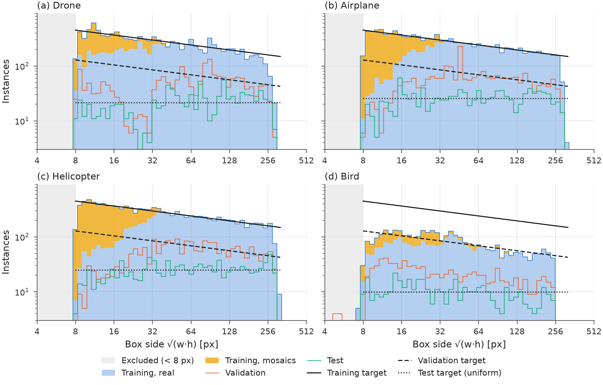
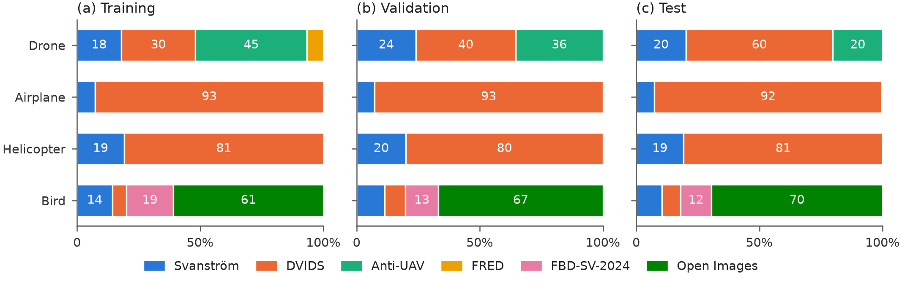
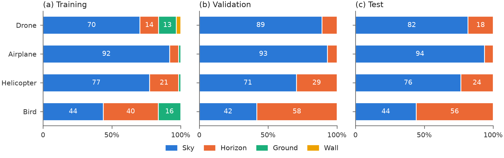
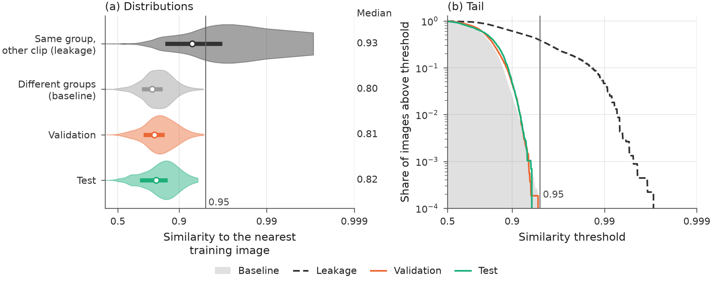
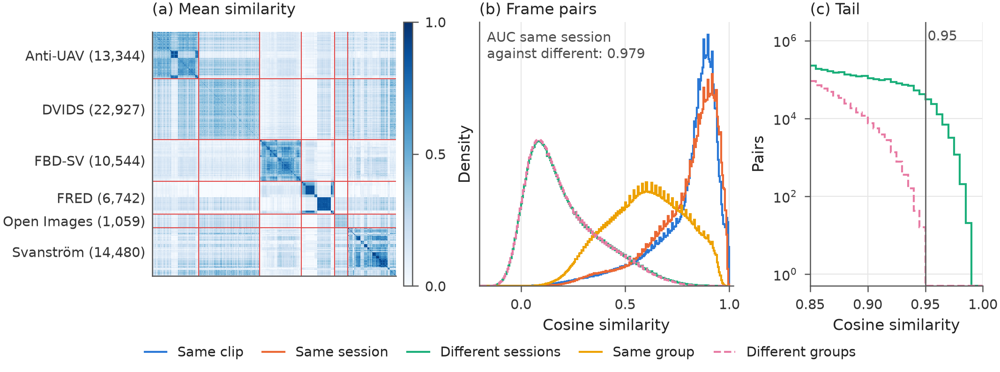
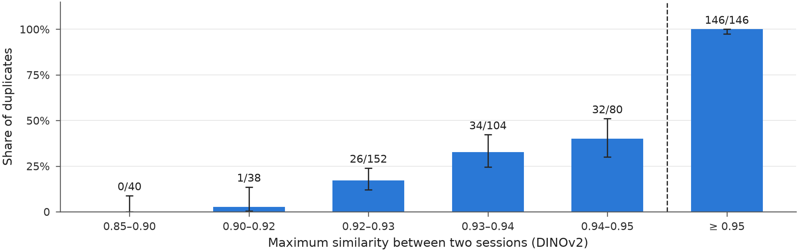
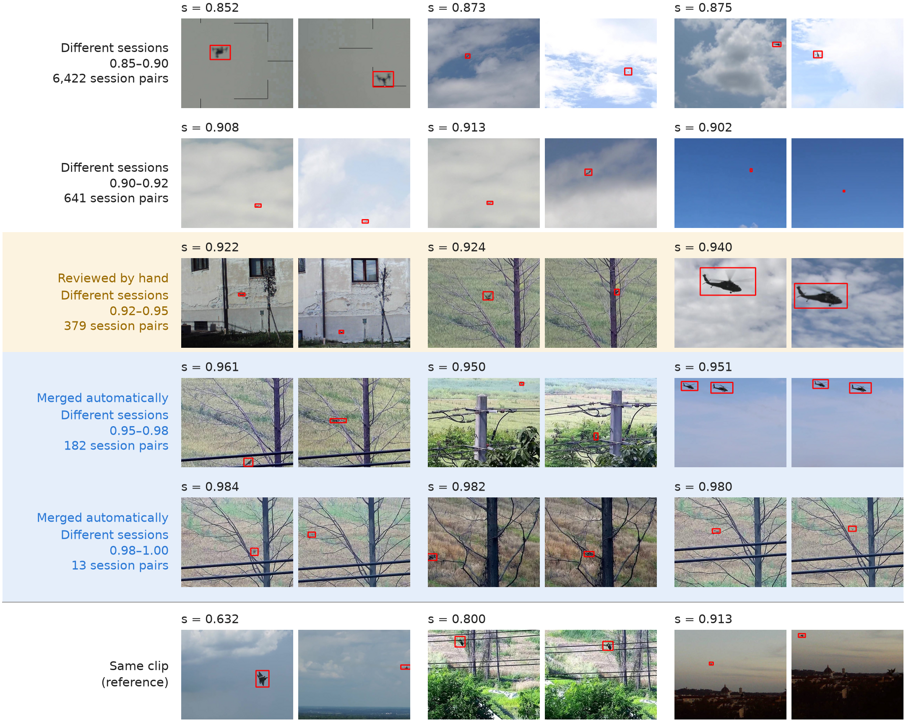

# VEDETTA

*[Versione italiana](README.md)*

Dataset for detecting **drones, airplanes, helicopters and birds** from a ground-based anti-drone turret, with an RGB
camera pointed at the sky and the horizon. It is built for the thesis (repo `yoloeval`):
- six public sources of objects, plus two of background only;
- labels reviewed by hand in CVAT and then with a review by candidates;
- **aligned with the domain**: val and test are sky and horizon only;
- split by recording and balanced by object size and by source.

The dataset is in `data/output/`, in Ultralytics YOLO format, and has been **frozen** since October 28, 2026: it is
not regenerated or modified.

| | |
|---|---|
| classes | `0 drone`, `1 airplane`, `2 helicopter`, `3 bird` |
| images | 640×512, never upscaled |
| splits | train 21,958, val 6,659, test 3,441, plus 511 int8 calibration images |
| instances per class | about 11,640–11,960 in train, about 1,960–2,350 in val, about 950–1,120 in test; birds: 3,477, 908, 433 |
| object size | √(w·h) from 8 to over 256 px, with extra examples where the object is small |

1. [The dataset](#the-dataset)
2. [Rules](#rules)
3. [Sources and licenses](#sources-and-licenses)
4. [Credits and citations](#credits-and-citations)
5. [Procedure](#procedure)
6. [Using the tools](#using-the-tools)

## The dataset

```
data/output/
├── dataset.yaml, calib.yaml      train/val/test and int8 calibration for Ultralytics
├── images/{train,val,test,calib}/
├── labels/{train,val,test,calib}/
├── raw/{images,labels}/          train + val + test in a single folder, to redo the splits
├── manifest.csv                  one row per image: split, type, group, source, clip, frame, scenario, weather, origin file
├── fonti_dvids.csv               page, author and license of every DVIDS video used
├── fonti_openimages.csv          author, license and page of every Open Images photo used
├── distribuzione, fonti, contesto, leakage (.png, .pdf; leakage.md)
└── README.md                     licenses, name legend, how to trace the origin
```

| split | images | real | mosaics | background |
|---|---|---|---|---|
| train | 21,958 | 18,397 | 511 | 3,050 |
| val | 6,659 | 5,759 | 0 | 900 |
| test | 3,441 | 2,925 | 0 | 516 |
| calib | 511 | 460 | 0 | 51 |

| class | train | of which from mosaics | val | test |
|---|---|---|---|---|
| drone | 11,637 | 3,301 | 1,964 | 945 |
| airplane | 11,959 | 4,065 | 2,352 | 1,123 |
| helicopter | 11,927 | 4,546 | 2,165 | 1,087 |
| bird | 3,477 | 763 | 908 | 433 |

File names tell the image type:
- `R_<group>_<clip>_<n>`: **real** image;
- `M_x<grid>_<n>`: **mosaic**, train only;
- `B_<camera>_<n>`: **background**, no labels.

`<clip>` and `<camera>` are the first 8 characters of the SHA-1 of `source:clip`. The `sorgente` column of
`manifest.csv` is the file the image comes from, relative to `data/`.

### Size distribution



**Figure 1.** *Instances by box side and class.*
- **Axes.** The x axis is the side √(w·h) in pixels, in log scale, with bins of about one eighth of an octave. The
  y axis is the boxes per bin, in log scale. Boxes under 8 px are excluded.
- **Training.** The filled areas are the real images (blue) and, on top of them, the mosaic boxes (yellow).
- **Validation and test.** The orange and green lines.
- **Targets** (black), all proportional to s^−0.3: training (solid line) and validation (dashed). The test target is
  uniform on the log scale (dotted).
- **Reading.**
  - Where the area is below the solid line, examples are missing.
  - Where a val or test line oscillates around its target, the band is covered.
- **Results.**
  - Airplanes and helicopters follow the training target up to 256 px, drones up to about 181 px. Above 256 px all
    classes are under the curve, because the sources have few examples that large.
  - Below 32 px the curve is reached thanks to the mosaics, which shrink large objects.
  - Birds are well below the training target (3,477 boxes against 11,640–11,960 for the other classes) and have no
    boxes above 256 px. Validation is also below its target; the test oscillates around its target.

### Sources per split



**Figure 2.** *Composition by source of training (a), validation (b) and test (c).*
- **Reading.** Each bar is a class, split into the share of boxes of each source. The numbers are percentages,
  written on segments of at least 12%. Mosaics count the source of their cells.
- **Results.**
  - For airplanes, helicopters and birds the three columns have similar shares: the split has a term on the source
    mix, and training a cap per source.
  - Airplanes come almost only from DVIDS (91–93%), helicopters about 80%.
  - Drones are the exception. In training, on the real boxes: Anti-UAV 34%, DVIDS 33%, Svanström 24% and FRED 9%;
    FRED is only in training, 6.7% with the mosaics. In val: DVIDS 40%, Anti-UAV 36%, Svanström 24%. In test: DVIDS
    60%, Anti-UAV 20%, Svanström 20%.
    - Anti-UAV has only 8 groups, all larger than the cap of one group in the test (15% of the target, 190 boxes).
      The test takes a single Anti-UAV group; DVIDS has more than 160 small groups.
    - A split with a balanced test costs about 950 real drones in training. The choice was to keep the data
      **[operator]**.
  - 67–70% of the val and test birds come from Open Images, birds in flight only (SigLIP filter). In training, on
    the real boxes: Open Images 57%, FBD-SV 21%, Svanström 16%.

### Context



**Figure 3.** *Background scenario by split and class: training (a), validation (b), test (c).*
- **Reading.** As Figure 2, with the scenario instead of the source. The four categories are assigned per clip
  **[operator]** and checked with the background texture:
  - **sky**: sky only;
  - **horizon**: sky with the horizon line;
  - **ground**: trees, fields, buildings;
  - **wall**: a wall as background.
- **Results.**
  - Val and test are sky and horizon only, the turret domain, with 7–26% horizon per class; birds are at 51–52%.
  - In training, ground and wall are at most 25% per class. They are 19% for birds (FBD-SV), 23% for drones (FRED
    and ground), 2–3% for airplanes and helicopters.
  - When the weather is annotated (`meteo` column of the manifest), it will appear as a second row.

### Leakage between splits



**Figure 4.** *Similarity between splits.* For each real image, the DINOv2 (ViT-S/14) cosine similarity with the
nearest real training image. The axis is stretched towards 1 (−log₁₀(1 − s)).
- **(a) Distributions.** Violin = distribution; dot = median, written on the right; bar = first and third quartile.
- **(b) Tail.** The share of images above each threshold, in log scale. The vertical line is the duplicate threshold,
  0.95.
- **References**, taken inside training:
  - "same group, other clip": what a real leakage looks like, median 0.932;
  - "different groups": the floor, because sky always looks like sky; median 0.802.
- **Reading.** If val or test had leakage, their curves would move towards the dashed one.
- **Results.**
  - Validation (median 0.798) and test (0.790) match the floor, also in the tail between 0.85 and 0.95.
  - No image exceeds 0.95. That is partly by construction, because pairs above 0.95 are in the same group. The match
    with the floor below 0.95 is not.

### Similarity between recordings



**Figure 5.** *DINOv2 similarity between all 69,096 annotated frames.*
- **(a) Matrix.** The mean similarity between blocks of consecutive frames, in order of source, session and clip.
  - Red lines separate the sources; the number of frames is in parentheses.
  - The area of each source is proportional to the square root of its frames, so Open Images (1,059) stays visible.
  - Dark blocks on the diagonal are recordings that are similar inside.
- **(b) Frame pairs.** The density of the similarity of all pairs, by type:
  - same clip;
  - same session and other clip;
  - different sessions;
  - same group and other session (the merged duplicates);
  - different groups.
- **(c) Tail.** The number of pairs above 0.85 between different sessions and between different groups, in log scale.
- **Results.**
  - DINOv2 separates the same session (median 0.84–0.85) from different sessions (0.17), with AUC 0.979.
  - Same-group pairs (median 0.61) sit in between: they are republished recordings or recordings shot in sequence.
  - Between different sessions the tail reaches 0.99. After the merges, no pair from different groups exceeds 0.95:
    the dashed curve stops at the threshold.
  - In the matrix, FRED and FBD-SV form separate blocks (wall and vegetation). Sky and horizon (Svanström, Anti-UAV,
    DVIDS, Open Images) resemble each other.

### The duplicate threshold



**Figure 6.** *Tuning of the duplicate threshold.* The bands are of the maximum similarity between two sessions.
- **Share of duplicates** among the pairs reviewed by hand **[operator]**. Next to each point, duplicates over the
  total; the error bar is the 95% Wilson interval. The background shows the rule: below 0.92 ignored, between 0.92 and 0.95 review by
  hand, above 0.95 automatic merge.
- **Results.** The share rises from 0/40 below 0.90 to 40% between 0.94 and 0.95; above 0.95 it is 146/146. Hence the
  rule: above 0.95 the merge is automatic, between 0.92 and 0.95 a review is needed.

Duplicate means the same recording (same moment, same light and sky) or the same footage published twice; the same
place on another day is not one.
- **Above 0.95:** 146 pairs reviewed, all duplicates.
- **Between 0.92 and 0.95:** 336 pairs reviewed, 92 duplicates (from 17% to 40% going up).
- **Below 0.92:** a sample of 78 pairs, 1 duplicate.

All confirmed duplicates are merged into the same group. The pairs above 0.95 from sessions added after the review
(Anti-UAV of October 26, 2026) are merged automatically with the same rule. They are the same recordings, so they are
not deleted: they end up in the same split. Below 0.92 only the same place at different times remains, that is the
accepted background leakage.



**Figure 7.** *Examples of frame pairs from different sessions by similarity band.*
- **Reading.**
  - Each row is a band: three pairs chosen at random (fixed seed), boxes in red, the similarity above each pair.
  - On the left, how many session pairs have their maximum similarity in the band.
  - In yellow the band reviewed by hand (0.92–0.95), in blue the automatic merge (≥ 0.95).
  - Pairs with a dark frame are not shown.
- **Results.**
  - Below 0.92 the pairs are similar skies from different recordings.
  - Above 0.95 they are the same framing, often with the same object a few seconds later.
  - Two frames of the same clip can drop to 0.63 when the object or the framing changes: a low similarity does not
    prove that two recordings are different.
- **Pairs reviewed.** Between 0.92 and 0.95 there are 380 session pairs: 357 reviewed and 23 already in the same
  group. No pair is left to review.

### Declared limits

- **Birds are under-represented.** There are few in the sky or at the horizon (Svanström, DVIDS, Open Images).
  FBD-SV-2024 is almost all vegetation, so it is only in train and within the out-of-domain share.
- **Fixed-wing drones excluded**: too few to be in all the splits.
- **Objects above 181 px** are under the train curve, for all classes.
- **Drones in val and test** are below the target (1,964 against 2,547 and 945 against 1,273), mostly between 16 and
  32 px: there are few independent drone videos, and a group cannot exceed 15% of a class or 75% of a cell.
- **Labels of the Anti-UAV drones added on October 26, 2026**: they are the original ones of the dataset.
- **Accepted background leakage**: the sources with sky have a background that repeats across different recordings,
  and it is accepted because in operation the turret is fixed.
- No object under 8 px and no night recording; no airplanes with a condensation or smoke trail.

## Rules

Set before touching the data and updated with the decisions taken during construction.

**Format**
- All images 640×512. Larger sources are **cropped** around the objects, without resizing: the label pixels are the
  ones the model sees.
- YOLO txt labels.

**Annotation**
- **Tight** box on the object, with the same rule for all sources.
- All visible objects of the 4 classes have a box, also in flocks (one per bird) and also perched birds.
- Blades and propellers in the box only if they are visible.
- Objects cut by the edge or occluded: box on the visible part.
- Objects outside the 4 classes (balloons, gliders, kites): no label, image kept.
- First review: all labels in CVAT, also those proposed by a detector or by SAM 2.
- Second review, by candidates: two independent detectors flag objects without a box, empty boxes and classes in
  disagreement. When in doubt about an object without a box or about a class, the frame is removed.
- Third review: every real image of the dataset in CVAT, one by one, also those added later. Night frames removed;
  a frame left without boxes is removed.

**Size**: s = √(w·h) in pixels.
- Boxes under 4 px² removed.
- Images with a box under 8 px removed from all splits. The whole image is removed, because removing only the box would
  leave an object without a label.

**Domain**
- Daytime recordings only, from the ground toward the sky or the horizon.
- Out: onboard footage, air-to-air, indoor, and smoke or condensation trails.
- Each clip has a **scenario**:
  - `cielo` (sky);
  - `orizzonte` (horizon): low flight, with trees, hills or buildings behind;
  - `terra` (ground): stationary or perched, taxiing, in the grass;
  - `muro` (wall): in front of facades or courtyards.
- **Val and test: sky and horizon only**, with the horizon around 20%. **Train**: ground and wall at most 25% per
  class, the same share for all classes, so the model does not tie the class to the background.
- Fixed-wing drones excluded.

**Target distribution**
- The density on a logarithmic scale goes as **s^−0.3** between 8 and 320 px, the same for all classes, and the total
  is raised ×1.2. It is an estimate: the true distribution of the domain is not known.
- The shape has two reasons:
  - an approaching target stays small for a long time, and it is when small that the classes get confused;
  - with the same curve for all classes, the model cannot tie the class to the size.
- From October 28, 2026 this is true for birds too, which stopped at 96 px before: the Open Images birds in flight
  reach 256 px.

**Balancing per split**
- **Train**, in this order:
  1. out-of-domain share;
  2. no session above 6% of a class;
  3. no source above 1.5 times its share in val and test;
  4. cap at 70% of the curve on quarter octaves.

  The missing small objects are compensated with **mosaics**: 2×2, 4×4 or 8×8 train crops reduced by ×0.5, ×0.25 or
  ×0.125, with light blur, noise and JPEG, never with boxes under 8 px.
  - The cells of a mosaic are taken **at random from the same half octave** of size, only from in-domain images, taking
    turns among sessions.
  - Ultralytics `scale` is not enough: it moves instances between sizes but does not add any.
- **Val**: 20% of the curve, never above 20% of the in-domain material. The Ultralytics fitness (the choice of
  `best.pt`) is computed on val and must weigh the sizes as in operation.
- **Test**: uniform on a logarithmic scale, for a reliable measurement at every size.
- **Sources**: in val and test each source has its share of the in-domain material, class by class.
- **Background**: about 10% of each split, from independent sources (sky and horizon only, no objects).
- **Never synthetic images** in val and test.

**Split by group**
- The unit is the **recording session**, that is the same place and the same conditions. Sessions that look alike
  become a **group**: duplicates confirmed by hand among the pairs with DINOv2 ≥ 0.92, plus every other pair ≥ 0.95.
- A group is entirely in one split: the same recording is never in two splits.
- In val and test a group gives only the in-domain frames and, if it is large, a random subset that does not exceed 75%
  of any cell of the target or 15% of the target of a class (October 27, 2026: before, one Anti-UAV group had 41% of
  the val drones). The rest of the group is not used: it cannot go in train.
- The assignment minimizes the distance from the targets, with at least 2,000 instances per class in val and 1,000 in
  test (and never above 20% of the in-domain material).
- A **waste** term (28/10/2026) makes the boxes that a group loses when it goes to val or test cost, drones ×4.
  Without it the split chose big groups and dropped 7,846 drones; with it, it drops 530 (2%).

**Sources**
- Open licenses only (public domain, CC0, CC BY, Apache, MIT), verified before download.
- Two declared exceptions: FBD-SV-2024 and Skyfinder (below).

## Sources and licenses

| source | what it gives | license | link |
|---|---|---|---|
| Svanström et al., Data in Brief 2021 | 640×512 videos of the 4 classes | CC0 1.0 | [GitHub](https://github.com/DroneDetectionThesis/Drone-detection-dataset) |
| FRED, Magrini et al., ACM MM 2025 | drones | Apache 2.0 | [Hugging Face](https://huggingface.co/datasets/GabrieleMagrini/FRED) |
| Anti-UAV300 (RGB), Jiang et al., IEEE TMM 2021 | drones | MIT | [GitHub](https://github.com/ZhaoJ9014/Anti-UAV) |
| DVIDS | airplanes, helicopters, drones, birds | public domain, video by video | [dvidshub.net](https://www.dvidshub.net) |
| Open Images V7, Kuznetsova et al., IJCV 2020 | birds in the sky | annotations CC BY 4.0, images CC BY 2.0 | [Open Images](https://storage.googleapis.com/openimages/web/index.html) |
| FBD-SV-2024, Sun et al., Scientific Data 2025 | birds | CC BY 4.0 | [figshare](https://figshare.com/articles/dataset/FBD-SV-2024/27377595) |
| Clouds-1500, Mendeley Data 2023 | background | CC BY 4.0 | [Mendeley](https://data.mendeley.com/datasets/2khchjbgzr/2) |
| SkyFinder, Mihail et al., WACV 2016 (copy by Nice and Wijnands 2019) | background | CC BY 4.0 | [Zenodo 2562396](https://zenodo.org/records/2562396) |

Licenses verified by the author on 06/11/2026. The dataset is on Hugging Face, [`Einrich99/vedetta`](https://huggingface.co/datasets/Einrich99/vedetta), under CC BY 4.0; every image keeps the license of its source.

Attribution:
- cite the papers of the sources;
- for DVIDS: "The appearance of U.S. Department of War (DoW) visual information does not imply or constitute DoW
  endorsement.";
- for Anti-UAV: include the copyright and the MIT license;
- for Open Images: author and link of every photo (CC BY 2.0), in `data/output/fonti_openimages.csv`.

Details, download links and the attribution sentence in `data/output/README.md`.

## Credits and citations

The dataset exists thanks to these sources. Anyone who uses it must cite the papers and respect the licenses.

| source | what we used | how to cite it and license |
|---|---|---|
| Svanström, Alonso-Fernandez, Englund | 284 RGB 640×512 videos | `svanstrom2021dataset`; data CC0 1.0 (data DOI 10.5281/zenodo.5500576), paper CC BY 4.0 |
| FRED, Magrini et al. | 10 RGB drone sequences | `magrini2025fred`; Apache 2.0, include the license |
| Anti-UAV, Jiang et al. | RGB recordings of Anti-UAV300 | `jiang2023antiuav` (online 2021, vol. 25 of 2023); MIT, include the copyright and the license |
| Open Images, Kuznetsova et al. | 1,059 crops with birds in flight | `kuznetsova2020openimages`; annotations CC BY 4.0 (Google), images CC BY 2.0: author and link in `data/output/fonti_openimages.csv` |
| FBD-SV-2024, Sun et al. | 483 bird videos | `sun2025fbdsv`; data on figshare (DOI 10.6084/m9.figshare.27377595, CC BY 4.0 according to DataCite) |
| Clouds-1500, Arrais et al. | background images | `arrais2023clouds1500`; CC BY 4.0 |
| SkyFinder, Mihail et al. | background images | `mihail2016sky`; downloaded from the copy by Nice and Wijnands (2019), "Dataset for: Sky pixel detection in outdoor imagery using an adaptive algorithm and machine learning", Zenodo, doi:10.5281/zenodo.2562396, CC BY 4.0 (`GSV` folder excluded); images from AMOS webcams |
| DVIDS | public-domain videos of airplanes, helicopters, drones and birds | no citation; mandatory sentence: "The appearance of U.S. Department of War (DoW) visual information does not imply or constitute DoW endorsement."; list of videos with author in `data/output/fonti_dvids.csv` |

```bibtex
@article{svanstrom2021dataset,
  author  = {Svanstr{\"o}m, Fredrik and Alonso-Fernandez, Fernando and Englund, Cristofer},
  title   = {A dataset for multi-sensor drone detection},
  journal = {Data in Brief},
  volume  = {39},
  pages   = {107521},
  year    = {2021},
  doi     = {10.1016/j.dib.2021.107521}
}

@inproceedings{magrini2025fred,
  author    = {Magrini, Gabriele and Marini, Niccol{\`o} and Becattini, Federico and Berlincioni, Lorenzo and
               Biondi, Niccol{\`o} and Pala, Pietro and Del Bimbo, Alberto},
  title     = {{FRED}: The Florence {RGB}-Event Drone Dataset},
  booktitle = {Proceedings of the 33rd ACM International Conference on Multimedia},
  pages     = {13170--13176},
  year      = {2025},
  doi       = {10.1145/3746027.3758271}
}

@article{jiang2023antiuav,
  author  = {Jiang, Nan and Wang, Kuiran and Peng, Xiaoke and Yu, Xuehui and Wang, Qiang and Xing, Junliang and
             Li, Guorong and Guo, Guodong and Ye, Qixiang and Jiao, Jianbin and Zhao, Jian and Han, Zhenjun},
  title   = {Anti-{UAV}: A Large-Scale Benchmark for Vision-Based {UAV} Tracking},
  journal = {IEEE Transactions on Multimedia},
  volume  = {25},
  pages   = {486--500},
  year    = {2023},
  doi     = {10.1109/TMM.2021.3128047}
}

@article{kuznetsova2020openimages,
  author  = {Kuznetsova, Alina and Rom, Hassan and Alldrin, Neil and Uijlings, Jasper and Krasin, Ivan and
             Pont-Tuset, Jordi and Kamali, Shahab and Popov, Stefan and Malloci, Matteo and Kolesnikov, Alexander and
             Duerig, Tom and Ferrari, Vittorio},
  title   = {The Open Images Dataset {V4}: Unified Image Classification, Object Detection, and Visual Relationship
             Detection at Scale},
  journal = {International Journal of Computer Vision},
  volume  = {128},
  pages   = {1956--1981},
  year    = {2020},
  doi     = {10.1007/s11263-020-01316-z}
}

@article{sun2025fbdsv,
  author  = {Sun, Zi-Wei and Hua, Ze-Xi and Li, Heng-Chao and Qi, Zhi-Peng and Li, Xiang and Li, Yan and
             Zhang, Jin-Chi},
  title   = {{FBD-SV-2024}: Flying Bird Object Detection Dataset in Surveillance Video},
  journal = {Scientific Data},
  volume  = {12},
  pages   = {530},
  year    = {2025},
  doi     = {10.1038/s41597-025-04872-6}
}

@misc{arrais2023clouds1500,
  author    = {Arrais, Juliana Marian and Cerentini, Allan and Juncklaus, Bruno and Polli, Marco and Chaves, Thiago and
               von Wangenheim, Aldo and Ricci, Gilberto and Mantelli, Sylvio and Silva, Caio and Rosa, Gabriel},
  title     = {Clouds-1500},
  year      = {2023},
  publisher = {Mendeley Data},
  version   = {2},
  doi       = {10.17632/2khchjbgzr.2}
}

@inproceedings{mihail2016sky,
  author    = {Mihail, Radu Paul and Workman, Scott and Bessinger, Zach and Jacobs, Nathan},
  title     = {Sky Segmentation in the Wild: An Empirical Study},
  booktitle = {IEEE Winter Conference on Applications of Computer Vision (WACV)},
  pages     = {1--6},
  year      = {2016},
  doi       = {10.1109/WACV.2016.7477637}
}
```

## Procedure

The operations done, in order. Each step has its own folder and reads only the previous steps.
**[operator]** = a person looks at numbered sheets and writes a text file, which the next step reads.

**For each source**, in `data/input/<source>/`:

1. **Download.**
   - Svanström videos and labels.
   - From FRED only the RGB + label block of the zips, with HTTP requests at intervals: no event data.
   - FBD-SV-2024 and Anti-UAV300 from the mirrors.
   - DVIDS with the API search and only the "PUBLIC DOMAIN" license.
   - Open Images: official annotations and lists with sha256 (`openimages/0_raw/scarica.sh`), images from the public
     CVDF bucket.
2. **Selection of recordings** **[operator]**.
   - Svanström: 341 clips from the scene cuts and 112 sessions, rebuilt on the sheets.
   - FRED: indoor and night sequences out.
   - DVIDS: stretches of ±5 s where the detector sees an aircraft. Out: onboard, air-to-air and ground footage, then
     smoke, grayscale and night vision; discards in `0_raw/esclusi.txt`, `fumo.txt`, `grigi.txt`, `verdi.txt`.
   - Open Images: only photos with individual birds (no group boxes, depictions or generic "aircraft"), classes Bird,
     Eagle, Falcon, Raven and Magpie, sky or horizon background. A SigLIP filter keeps only the birds in flight
     (probability ≥ 0.7 or most probable scene); 10 rejects by hand in `5_box/scarti_volo.txt`.
   - DVIDS, from round 12 (28/10/2026): at most 40 frames per video, 1 per second (`frame --per-video 40`).
3. **Near-duplicates** inside each clip, on the frame at its original resolution and before the crop: 16-bit dHash of
   the area around the boxes, plus number, position and size of the boxes (frames without boxes use the dHash of the
   whole frame). Svanström is deduplicated after its boxes are redone and reviewed (steps 5 and 6), and 17% of its
   frames remain; Open Images, made of single photos, skips this step.
4. **640×512 frames and crops** around the objects (FRED, DVIDS, Anti-UAV, FBD, Open Images); Svanström is already
   640×512. Anti-UAV: one frame every 25, plus the halfway ones for drones above 32 px (October 26, 2026, at most 30
   per video).
5. **Proposed boxes**:
   - Svanström: local contrast and SAM 2 with one point;
   - FRED: detector on the sky and still background in the courtyards;
   - DVIDS: detector;
   - FBD, Anti-UAV and Open Images: original boxes.

   Then the **preselection**: video class for DVIDS, out the close-ups, the night, boxes under 4 px², double boxes
   and the DVIDS logo star.
6. **CVAT review** of all the kept frames **[operator]**, with a second check on a sample (1 frame every 10).
   Return into `5_box/manuale/`.
7. **Sessions** of each source: dates and times of the files, then DINOv2 groups of the clips reviewed on the sheets.

**On all sources**, in `data/intermediate/`:

8. `9_split`: table of the 69,096 annotated frames (83,262 boxes) and DINOv2 ViT-S/14 embedding of each frame.
9. `10_doppioni`: duplicates between sessions, reviewed on the sheets **[operator]**.
   - Above 0.95: 146 pairs, all duplicates (`unire.txt`).
   - Tuning: 160 sampled pairs between 0.85 and 0.95 (`taratura/`); duplicates only from 0.92 up.
   - Full review of the other 254 pairs between 0.92 and 0.95 (`fascia_092/`).
   - The 26 pairs between 0.92 and 0.95 of sessions added later (`fascia_092_b/`): 18 duplicates (13 at night).
   - The 2 pairs between 0.92 and 0.95 of the DVIDS videos of round 12 (`fascia_092_c/`, October 28, 2026): 1
     duplicate.
   - In total 94 duplicates below 0.95, almost all FBD (fixed cameras).
10. `11_gruppi`: known sessions, reviewed duplicates and every other pair ≥ 0.95 → **2,032 groups** (from 2,219
    sessions).
11. `12_scenario`: scenario of each clip **[operator]**.
    - Contact sheets of 5 frames per clip.
    - Proposals in `proposte/`, user corrections in `correzioni.csv`, check with the background texture
      (`metrica.csv`).
    - Clips with fixed-wing drones are marked here.
12. `13_revisione`: review of the labels by candidates **[operator]**.
    - Two independent detectors on all frames (`pred.pkl`).
    - 4,277 candidates in sheets of 24.
    - Decisions in `decisioni/`: 632 boxes added, 677 empty labels removed, 63 classes changed.
13. `14_background`: Clouds-1500 and Skyfinder.
    - 640×512 crops without upscaling.
    - Out those where the detector sees an object (confidence 0.1).
    - Near-duplicates per camera (DINOv2 < 0.95).
    - **[operator]** review: 17 removed.
    - About 10% per split, by whole cameras.
14. `15_dataset`: the frame table.
    - `tabella`: scenario, fixed wing removed, corrected labels in `label/`, out the doubtful frames and those with
      boxes under 8 px.
15. `16_cvat`: full review in CVAT **[operator]** (`tools/cvat_output.py`).
    - Every real image of the first export (26/10/2026): 655 boxes changed, 1,000 Anti-UAV night frames deleted,
      213 frames left without boxes.
    - Then, at every new split, the frames not reviewed yet (`nuovi_<round>.csv`): 2,597, 1,400 and 893 frames; on October 27, 2026
      785 frames reviewed on sheets (round `17d`), with 19 frames of one recording changed from drone to helicopter,
      then 292 (round `17e`). On October 28, 2026: 287 new DVIDS frames (round `17f`), then in CVAT all the frames not
      reviewed yet of the three splits (rounds `17g`, `17h`, `17i`: 1,117, 525 and 96 frames; 130 boxes changed, 33
      frames left without boxes). After the split with seed 3: 199 and 18 frames (rounds `17j`, `17k`), 4 boxes
      changed.
      Then a helicopter on the ground without boxes in two Svanström clips of val (round `17l`, 131 frames, 57 boxes
      added with a CVAT track) and 12 frames not reviewed after the new split (round `17m`, 2 boxes changed).
      In the final dataset all real frames are reviewed: the last DVIDS frame of train was reviewed outside CVAT on October 30, 2026 (round `17n`, unchanged).
    - Corrected labels in `label/`, as copies: the labels of the sources stay the original ones.
16. `17_dataset`: the dataset.
    - `rivisti`: the labels of the review; out the deleted or empty frames, the night group, dark frames (mean grey
      < 30) and the clips where the review removed a box.
    - `split`: groups into train, val and test (1,000 random orders in parallel, the best is kept; seed 3, the best
      of 4 for the training drones). Reviewed frames first; test at most half of the validation per class; horizon
      share and sources as in the pool. A waste term weighs the boxes that a group sent to val or test loses to the
      excess (weight 4 for drones).
    - `train`: shares and caps; frames not reviewed are removed first.
    - `mosaici`: from the same half octave, only from reviewed frames, with the source cap of the train.
    - `export`: into `data/output/`, with hardlinks of the images, labels in the new class order, calib, manifest,
      README and figures.

## Using the tools

```bash
python3 -m venv .venv && .venv/bin/pip install -r requirements.txt
cp .env.example .env                     # then fill in: model weights, CVAT credentials
export NO_PROXY=localhost,127.0.0.1      # local CVAT, if there is a system proxy
```

`.env` says which models to use. The weights are in `models/`, outside git:
- `DETECTOR_PESI`: detector of the proposals, private weights, never in the repo;
- `SAM_PESI`: SAM 2.1, downloaded by Ultralytics on first use;
- `REVIEW_PESI`: the second detector of the review by candidates.

The scripts are run from the repo root with `.venv/bin/python` and `PYTHONPATH=.`. The parameters of each step are
in `--help`. CVAT credentials missing from `.env` are read from `~/.config/cvat.env`. SigLIP and DINOv2 stay in the
Hugging Face cache: if the proxy gives an error, `HF_HUB_OFFLINE=1`.

```
models/             .pt weights (outside git)
data/
├── input/          sources, one folder per step: svanstrom, fred, dvids, anti_uav, fbd_sv, openimages,
│                   clouds1500, skyfinder, background (the choices, as hardlinks)
├── intermediate/   steps on all sources: 9_split … 17_dataset (deprecated_*: superseded steps, to be deleted)
└── output/         the final dataset (frozen)
```

Of `input/` and `intermediate/`, git holds only the operator choices, lists and logs (files under 5 MB) and the
labels reviewed in CVAT (`manuale.tar.gz` per source); raw data is downloaded again by the download steps. `output/`
goes to Hugging Face, in a private dataset repo.

### Svanström: `tools/svanstrom.py`

```bash
python tools/svanstrom.py --step frames        # download, frames and .mat labels -> 1_frame
python tools/svanstrom.py --step tagli         # scene-cut candidates -> 2_sequenze/candidati  [operator: tagli.txt]
python tools/svanstrom.py --step sequenze      # true cuts -> 2_sequenze/sequenze.csv
python tools/svanstrom.py --step sessioni      # session proposal -> 3_sessioni/fogli  [operator: correzioni.txt]
python tools/svanstrom.py --step unione        # proposal + corrections -> 3_sessioni/sessioni.csv
python tools/svanstrom.py --step box           # contrast boxes, clean and difficult clips -> 4_box
python tools/svanstrom.py --step sam           # SAM 2 with one point on the difficult clips
python tools/svanstrom.py --step fogli_sam     # check sheets of the SAM boxes
python tools/svanstrom.py --step cvat          # CVAT task 'box', whole-clip jobs  [operator: review]
python tools/svanstrom.py --step cvat_import   # CVAT YOLO zips in 4_box/cvat_zip -> 4_box/manuale
python tools/svanstrom.py --step meteo         # weather per clip (SigLIP) -> CVAT task 'meteo'  [operator]
python tools/svanstrom.py --step meteo_import  # -> 5_meteo/meteo.csv
python tools/svanstrom.py --step dedup         # near-duplicates inside the clip -> 6_dedup/tenuti.csv
python tools/svanstrom.py --step fogli_dedup   # check sheets of the deduplication
python tools/svanstrom.py --step conta         # instances per class and band -> 7_conteggio
```

### FRED: `tools/fred.py`

```bash
python tools/fred.py --step label              # labels only of all sequences -> 0_raw
python tools/fred.py --step anteprima          # one frame per sequence, to remove the indoor ones  [operator]
python tools/fred.py --step frame --seq 107 210  # RGB block + labels -> 1_frame
python tools/fred.py --step annotati --seq ...   # remove frames without boxes -> 2_annotati
python tools/fred.py --step dedup --seq ...      # near-duplicates -> 3_dedup
python tools/fred.py --step ritaglio --seq ...   # 640x512 -> 4_ritagli
python tools/fred.py --step sam | yolo | movimento --seq ...                    # proposed boxes -> 5_box/<method>
python tools/fred.py --step fogli_sam | fogli_yolo | fogli_movimento --seq ...  # check sheets
python tools/fred.py --step proposte --seq ...   # detector on the sky, motion on the courtyards -> 5_box/proposte
python tools/fred.py --step sessioni           # sessions by day and time -> 6_sessioni
python tools/fred.py --step conta              # -> 7_conteggio
python tools/fred.py --step cvat | cvat_import # review in CVAT -> 5_box/manuale
```

### FBD-SV-2024, Anti-UAV, DVIDS: `tools/extra_sources.py`

```bash
python tools/extra_sources.py --fonte fbd --step frame       # videos + XML -> 1_frame
python tools/extra_sources.py --fonte antiuav --step frame   # images from the mirror -> 1_frame
python tools/extra_sources.py --fonte antiuav --step frame_extra  # drones > 32 px among the used frames -> 8_extra
python tools/extra_sources.py --fonte dvids --step cerca --classe airplane     # DVIDS API -> 0_raw/candidati.csv
python tools/extra_sources.py --fonte dvids --step info --classe airplane      # license, author, mp4 -> 0_raw/video.csv
python tools/extra_sources.py --fonte dvids --step anteprima --classe airplane # one frame every 10 s
python tools/extra_sources.py --fonte dvids --step doppioni  # videos republished with another id
python tools/extra_sources.py --fonte dvids --step scegli    # stretches with an aircraft in the sky -> 0_raw/tratti.csv
python tools/extra_sources.py --fonte dvids --step fogli [--grandezza 96 | --minimo 48]  # [operator: scartiN.txt]
python tools/extra_sources.py --fonte dvids --step escludi --fogli fogli_trattiN --scarti data/input/dvids/0_raw/scartiN.txt
python tools/extra_sources.py --fonte dvids --step frame --classe airplane [--secondi 600]  # 5 fps + detector -> 1_frame
python tools/extra_sources.py --fonte dvids --step fogli_fumo | fogli_grigi | fogli_verdi  # [operator]
python tools/extra_sources.py --fonte dvids --step fumo | grigi | verdi --fogli <folder> --scarti <file>
python tools/extra_sources.py --fonte <source> --step catena    # annotati, dedup, ritaglio, proposte
python tools/extra_sources.py --fonte <source> --step sessioni  # DINOv2 groups of the clips -> 6_sessioni
python tools/extra_sources.py --fonte <source> --step conta | cvat | cvat_import
python tools/preselection.py      # preselection on all sources -> 5_box/preselezione (after every chain)
python tools/sample.py --step fogli --nome N --fonti dvids:70 fred:20   # sample to estimate the work in CVAT
python tools/sample.py --step stima --nome N
```

### Open Images: `tools/openimages.py`

```bash
data/input/openimages/0_raw/scarica.sh              # annotations and lists, with sha256 and date
python tools/openimages.py --step candidati         # photos with individual and small birds -> 1_candidati.csv
python tools/openimages.py --step immagini          # public CVDF bucket -> 2_immagini
python tools/openimages.py --step ritagli           # 640x512 on the sky -> 4_ritagli, 5_box/manuale, 5_box/ritagli.csv
python tools/openimages.py --step volo              # SigLIP: birds in flight only, double boxes out -> 5_box/volo.csv
```

Round 2 (28/10/2026): `candidati --lato 0.3`, `ritagli --max-px 256`, then `volo`. If the proxy fails towards Hugging
Face, `HF_HUB_OFFLINE=1` uses the cached model.

### Background: `tools/background.py`

```bash
python tools/background.py --fonte clouds1500 --step ritagli   # 640x512 on the sky-horizon band -> 1_ritagli
python tools/background.py --fonte clouds1500 --step detector  # remove the crops with an object -> 2_detector
python tools/background.py --fonte clouds1500 --step dedup     # near-duplicates per camera -> 3_dedup
python tools/background.py --fonte clouds1500 --step fogli     # sample of kept and excluded  [operator]
python tools/background.py --step split                        # ~10% per split -> intermediate/14_background
python tools/background.py --step raccolta                     # choices as hardlinks -> input/background/0_raw
```

Same steps with `--fonte skyfinder`.

### On all sources

```bash
python tools/split.py --step frame               # annotated frames of all sources -> 9_split/frame.csv
python tools/split.py --step embedding           # DINOv2 ViT-S/14 per frame -> 9_split/embedding_s.npy
python tools/split.py --step somiglianze         # plot on a sample
python tools/split.py --step anteprima [--fasce 0.95 0.99 1.01]  # pairs of different sessions by band
python tools/split.py --step doppioni            # pairs >= 0.95 to review -> 10_doppioni  [operator: unire.txt]
python tools/split.py --step taratura            # sample per band 0.85-0.95 -> 10_doppioni/taratura  [operator: stessa_sessione.txt]
python tools/split.py --step esito_taratura      # colored sheets with the operators' judgments
python tools/split.py --step stima_soglia        # share of duplicates per band -> taratura/stima.csv
python tools/split.py --step revisione_fascia    # all unjudged pairs 0.92-0.95 -> 10_doppioni/fascia_092  [operator]
python tools/split.py --step revisione_nuove     # pairs 0.92-0.95 of the added sessions -> 10_doppioni/fascia_092_b  [operator]
python tools/split.py --step gruppi              # -> 11_gruppi/gruppi.csv
python tools/split.py --step somiglianze_gruppi  # similarity figure -> docs/figure (names it_<name>, en_<name>)
python tools/split.py --step soglia              # panel of pairs per band -> docs/figure
python tools/split.py --step figure              # threshold tuning -> docs/figure
python tools/scenario.py --step fogli            # contact sheets per clip -> 12_scenario/fogli  [operator: proposte/]
python tools/scenario.py --step metrica          # background texture around the boxes -> 12_scenario/metrica.csv
python tools/review.py --step predizioni         # two detectors on all frames -> 13_revisione/pred.pkl
python tools/review.py --step candidati          # -> 13_revisione/candidati.csv
python tools/review.py --step fogli              # -> 13_revisione/fogli  [operator: decisioni/]
python tools/dataset.py --step tabella           # -> 15_dataset/frame.csv, label/, esclusi.csv
python tools/cvat_output.py --step carica        # dataset in CVAT, project output_26ott  [operator: review]
python tools/cvat_output.py --step importa       # -> 16_cvat/frame.csv, modifiche.csv, label/
python tools/dataset.py --step rivisti           # -> 17_dataset/frame.csv, esclusi.csv
python tools/dataset.py --step split             # -> 17_dataset/split.csv (20 processes)
python tools/dataset.py --step train             # -> 17_dataset/train.csv, tolti.csv
python tools/cvat_output.py --step carica_nuovi --giro 17b   # frames not reviewed -> project nuovi_17  [operator]
python tools/cvat_output.py --step importa_nuovi --giro 17b  # -> 16_cvat/nuovi_17b.csv; then rivisti again
python tools/dataset.py --step mosaici           # -> 17_dataset/mosaici/, mosaici.csv
python tools/dataset.py --step export            # -> data/output (refuses if it already exists)
python tools/dataset.py --step figure            # distribution, sources, context, leakage -> docs/figure and data/output
python tools/distributions.py                    # available sizes and Ultralytics scales -> docs/figure
```

### Code

| file | content |
|---|---|
| `tools/common.py` | classes, bands, deduplication, session proposal, CVAT client, detector |
| `tools/pipeline.py` | common chain of the added sources: annotati, dedup, ritaglio, proposed boxes, count, CVAT |
| `tools/svanstrom.py`, `fred.py`, `extra_sources.py`, `openimages.py`, `background.py` | one source each |
| `tools/preselection.py`, `sample.py` | preselection before CVAT, samples to estimate the review |
| `tools/split.py` | frame table, embeddings, duplicates, groups, threshold figures |
| `tools/scenario.py`, `review.py` | scenario per clip and review of the labels by candidates |
| `tools/cvat_output.py` | full review in CVAT: uploads the dataset and the new frames, imports the corrections |
| `tools/dataset.py` | final table, split, train, mosaics, export, dataset figures |
| `tools/distributions.py`, `plots.py` | target curve and plot style |
| `docs/dataset_readme.md` | template of the `data/output` README (written by the export) |
| `docs/procedura_ideale.md` | general procedure, drawn from this work, to build a similar dataset from other sources (Italian) |
| `.env.example` | which models to use and CVAT credentials, to copy into `.env` |
