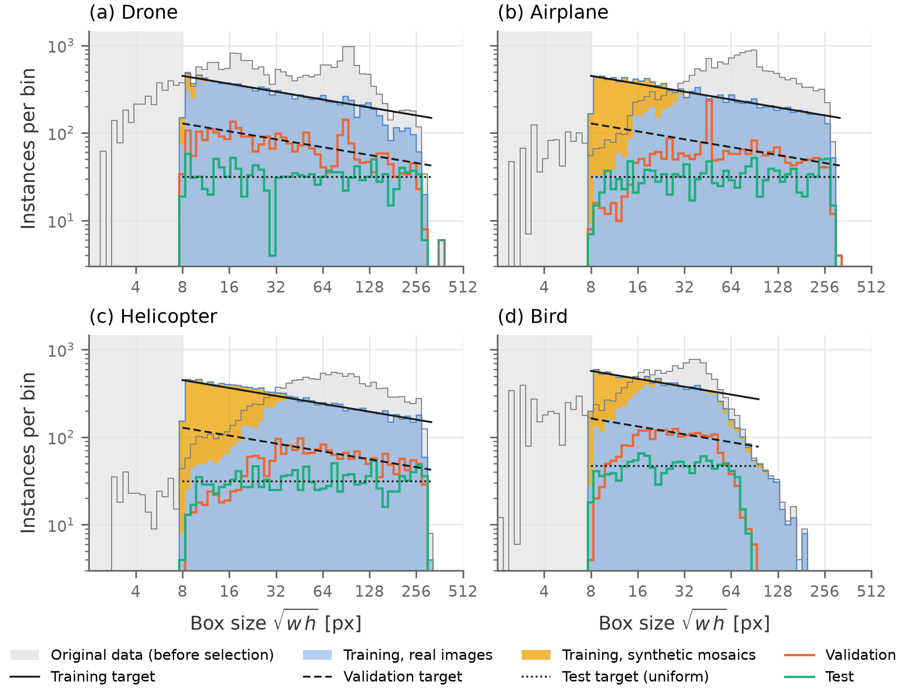
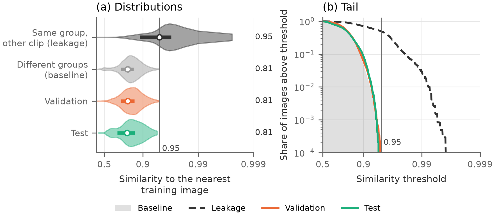
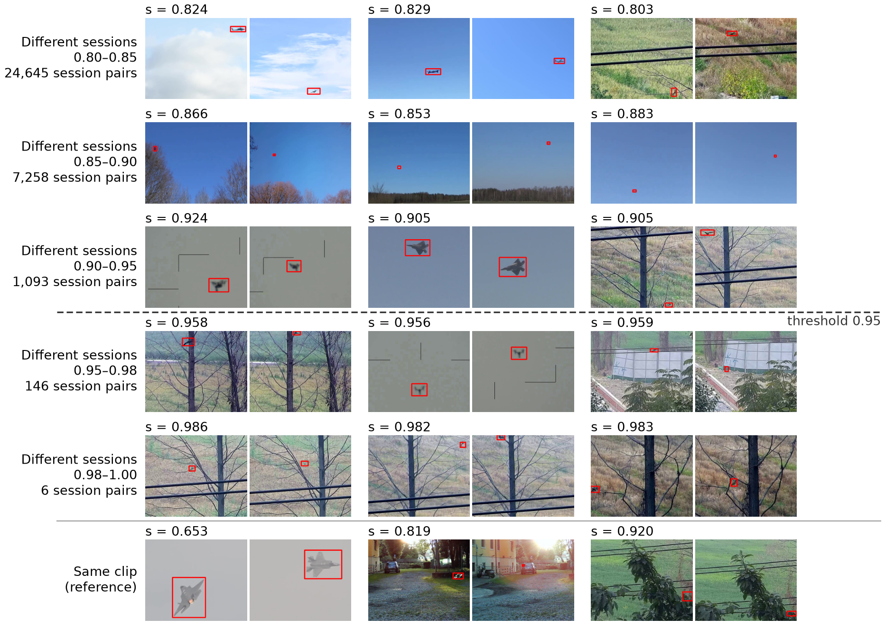

# air-detection

*[Versione italiana](README.md)*

Dataset for detecting **drones, airplanes, helicopters and birds** from a ground-based anti-drone turret, with an RGB
camera pointed at the sky. Built for the thesis (repo `yoloeval`) from six public sources, manually reviewed in CVAT,
split by recording and balanced by object size. The final dataset is in `data/output/`, in Ultralytics YOLO format, and
has been **frozen** since October 23, 2026: it is not regenerated or modified.

| | |
|---|---|
| classes | `0 drone`, `1 airplane`, `2 helicopter`, `3 bird` |
| images | 640×512, never upscaled |
| splits | train 30,579, val 9,013, test 5,165, plus 512 int8 calibration images |
| instances per class | ≥ 10,000 in train, ≥ 2,000 in val, ≥ 1,000 in test |
| object size | √(w·h) from 8 to over 256 px, with extra examples where the object is small |

1. [The dataset](#the-dataset)
2. [Rules](#rules)
3. [Sources and licenses](#sources-and-licenses)
4. [Credits and citations](#credits-and-citations)
5. [Procedure](#procedure)
6. [Using the tools](#using-the-tools)

## The dataset

```
data/output/
├── dataset.yaml, calib.yaml      train/val/test and int8 calibration for Ultralytics
├── images/{train,val,test,calib}/
├── labels/{train,val,test,calib}/
├── raw/{images,labels}/          train + val + test in a single folder, to redo the splits
├── manifest.csv                  one row per image: split, type, group, source, clip, frame, source file
├── fonti_dvids.csv               page, author and license of every DVIDS video used
├── distribuzione.{png,pdf,md}, leakage.{png,pdf,md}
└── README.md                     licenses, legend of the names, how to trace the origin
```

| split | images | real | mosaics | background |
|---|---|---|---|---|
| train | 30,579 | 26,580 | 949 | 3,050 |
| val | 9,013 | 8,113 | 0 | 900 |
| test | 5,165 | 4,649 | 0 | 516 |
| calib | 512 | 461 | 0 | 51 |

| class | train | of which from mosaics | val | test |
|---|---|---|---|---|
| drone | 11,304 | 475 | 3,077 | 1,419 |
| airplane | 12,128 | 4,334 | 2,275 | 1,367 |
| helicopter | 12,423 | 5,169 | 2,173 | 1,372 |
| bird | 11,142 | 3,223 | 2,248 | 1,246 |

File names give the image type:
- `R_<gruppo>_<clip>_<n>`: **real** image;
- `M_x<griglia>_<n>`: **mosaic**, train only;
- `B_<camera>_<n>`: **background**, no labels.

`<clip>` and `<camera>` are the first 8 characters of the SHA-1 of `fonte:clip`. The `sorgente` column of
`manifest.csv` is relative to `data/` as it was before the folders were reorganized: today it must be read under
`data/input/`, and under `data/intermediate/` in place of `aggregati/`.

### Size distribution



Instances by size and class:
- **blue**: real train;
- **yellow**: mosaics;
- **colored lines**: val and test;
- **gray shading**: all data available before selection;
- **black**: the targets.

Error of each split relative to its target, per half octave (tables in `data/output/distribuzione.md`):
- **Train**: follows the target within 5–10%.
- **Test**: follows the target within 7–16%.
- **Val**: falls below the curve on small objects for airplanes, helicopters and birds (error 35–37%), because real data
  is insufficient there and no synthetic images are used in val.

### Leakage between splits



For each val and test image, the DINOv2 similarity to the most similar train image. The comparison uses two references
taken within train:
- **same group, different clip**: what a true leakage looks like, median 0.954;
- **different groups**: the baseline, since sky always resembles sky; median 0.819.

Val (median 0.820) and test (0.818) match the baseline. No val or test image exceeds 0.95.

### The 0.95 threshold



Frame pairs from different sessions by cosine-similarity bin (DINOv2), three per bin, chosen at random; at the bottom,
pairs from the same clip as a reference.
- Above 0.95 they are the same scene: same place, same camera, often the same footage. The 146 session pairs above the
  threshold were reviewed by hand and all merged into the same group.
- Already between 0.90 and 0.95 the same place and camera appear on different days: this is background leakage,
  accepted.
- Two frames of the same clip can drop to 0.65 when the object changes a lot: low similarity does not prove that two
  recordings are different.

The panel therefore justifies 0.95 as the threshold for **duplicates** (same recording), not as the boundary between
identical and different recordings. The proof that the splits are separate is the leakage figure.

### Stated limitations

- Val has few airplanes, helicopters and birds under 16 px: real data is insufficient.
- The small drones in val and test come from few flights: 5–6 groups per bin under 32 px.
- Birds above 96 px are in train only: too few to measure them.
- Sources with sky have a background that repeats across different recordings. This background leakage is accepted,
  because in operation the turret is fixed.
- No objects under 8 px and no night recordings.
- No airplanes with contrails or smoke trails.

## Rules

Set before touching the data and updated with the decisions made during construction.

**Format**
- All images 640×512. Larger sources are **cropped** around the objects, without resizing: the label pixels are those
  the model sees.
- YOLO txt labels.

**Annotation**
- **Tight** box around the object, with the same rule for all sources.
- All visible objects of the 4 classes get a box, including in flocks (one per bird).
- Blades and propellers in the box only if visible.
- Objects cut by the border or occluded: box on the visible part.
- Objects outside the 4 classes (hot-air balloons, gliders, kites): no label, image kept.
- All labels were manually reviewed in CVAT, including those proposed by a detector or by SAM 2.

**Size**: s = √(w·h) in pixels.
- Boxes under 4 px² removed.
- Images with a box under 8 px removed from all splits. The whole image is removed, because removing only the box would
  leave an object without a label.

**Domain**
- Daytime recordings only, from the ground toward the sky or horizon.
- Excluded: onboard, air-to-air and indoor recordings, ground close-ups, and smoke or contrail trails.

**Target distribution**
- The density on a logarithmic scale follows **s^−0.3** between 8 and 320 px, the same for all classes, and the total is
  raised ×1.2. This is an estimate: the true distribution of the domain is not known.
- The shape has two reasons:
  - an approaching target stays small for a long time, and it is when small that classes get confused;
  - with the same curve for all classes, the model cannot tie the class to the size.
- Birds stop at 96 px: above that there are too few.

**Balancing per split**
- **Train**: cap at 70% of the curve, on quarter octaves. The missing small objects are compensated with **mosaics**:
  2×2, 4×4 or 8×8 train crops scaled down by ×0.5, ×0.25 or ×0.125, with light blur, noise and JPEG, never with boxes
  under 8 px. The Ultralytics `scale` is not enough: it moves instances between sizes but does not add any.
- **Val**: 20% of the curve, because the Ultralytics fitness (the choice of `best.pt`) is computed on val and must weight
  the sizes as in operation.
- **Test**: uniform on a logarithmic scale, for a reliable measurement at every size.
- **Background**: 10% of every split, from independent sources (sky and horizon only, no objects).
- **No synthetic images** in val and test.

**Split by group**
- The unit is the **recording session**, i.e. same place and same conditions. Sessions that resemble each other
  (DINOv2 ≥ 0.95, manually reviewed) become a **group**.
- A group lies entirely in one split: the same recording is never in two splits.
- Proportions about 70/20/10. The assignment minimizes the distance from the targets, with at least 2,000 instances per
  class in val and 1,000 in test.

**Sources**
- Open licenses only (public domain, CC0, CC BY, Apache, MIT), verified before download.
- Two declared exceptions: FBD-SV-2024 and Skyfinder (below).

## Sources and licenses

| source | provides | license | link |
|---|---|---|---|
| Svanström et al., Data in Brief 2021 | 640×512 videos of the 4 classes | CC0 1.0 | [GitHub](https://github.com/DroneDetectionThesis/Drone-detection-dataset) |
| FRED, Magrini et al., ACM MM 2025 | drones | Apache 2.0 | [Hugging Face](https://huggingface.co/datasets/GabrieleMagrini/FRED) |
| Anti-UAV300 (RGB), Jiang et al., IEEE TMM 2021 | drones | MIT | [GitHub](https://github.com/ZhaoJ9014/Anti-UAV) |
| DVIDS | airplanes, helicopters, drones | public domain, video by video | [dvidshub.net](https://www.dvidshub.net) |
| FBD-SV-2024, Sun et al., Scientific Data 2025 | birds | **research only, non-commercial** ⚠ | [figshare](https://figshare.com/articles/dataset/FBD-SV-2024/27377595) |
| Clouds-1500, Mendeley Data 2023 | background | CC BY 4.0 | [Mendeley](https://data.mendeley.com/datasets/2khchjbgzr/2) |
| SkyFinder, Mihail et al., WACV 2016 (copy by Nice and Wijnands 2019) | background | CC BY 4.0 on the Zenodo record, but images from third-party AMOS webcams ⚠ | [Zenodo 2562396](https://zenodo.org/records/2562396) |

⚠ FBD-SV-2024 and Skyfinder are used because the dataset serves a research thesis. They can be separated via the
`fonte` column of `manifest.csv` and must be removed before publishing the dataset or using it commercially.

Attribution:
- cite the source papers;
- for DVIDS: "The appearance of U.S. Department of War (DoW) visual information does not imply or constitute DoW
  endorsement.";
- for Anti-UAV: reproduce the copyright and MIT license.

Details, download links and the attribution sentence are in `data/output/README.md`.

## Credits and citations

This dataset exists thanks to the sources below. Users must cite the papers and respect the licenses.

| source | what we used | how to cite and license |
|---|---|---|
| Svanström, Alonso-Fernandez, Englund | 284 RGB videos, 640×512 | `svanstrom2021dataset`; data CC0 1.0 (data DOI 10.5281/zenodo.5500576), paper CC BY 4.0 |
| FRED, Magrini et al. | 10 RGB drone sequences | `magrini2025fred`; Apache 2.0, include the license |
| Anti-UAV, Jiang et al. | RGB recordings of Anti-UAV300 | `jiang2023antiuav` (online 2021, vol. 25, 2023); MIT, include the copyright notice and license |
| FBD-SV-2024, Sun et al. | 483 bird videos | `sun2025fbdsv`; data on figshare (DOI 10.6084/m9.figshare.27377595, CC BY 4.0 per DataCite), but the dataset readme says "for learning and research purposes only, not for commercial use" ⚠ |
| Clouds-1500, Arrais et al. | background images | `arrais2023clouds1500`; CC BY 4.0 |
| SkyFinder, Mihail et al. | background images | `mihail2016sky`; downloaded from the copy by Nice and Wijnands (2019), "Dataset for: Sky pixel detection in outdoor imagery using an adaptive algorithm and machine learning", Zenodo, doi:10.5281/zenodo.2562396, CC BY 4.0 (`GSV` folder excluded); images from AMOS webcams, AMOS terms not verified ⚠ |
| DVIDS | public-domain videos of airplanes, helicopters and drones | no citation; required statement: "The appearance of U.S. Department of War (DoW) visual information does not imply or constitute DoW endorsement."; list of videos with authors in `data/output/fonti_dvids.csv` |

```bibtex
@article{svanstrom2021dataset,
  author  = {Svanstr{\"o}m, Fredrik and Alonso-Fernandez, Fernando and Englund, Cristofer},
  title   = {A dataset for multi-sensor drone detection},
  journal = {Data in Brief},
  volume  = {39},
  pages   = {107521},
  year    = {2021},
  doi     = {10.1016/j.dib.2021.107521}
}

@inproceedings{magrini2025fred,
  author    = {Magrini, Gabriele and Marini, Niccol{\`o} and Becattini, Federico and Berlincioni, Lorenzo and
               Biondi, Niccol{\`o} and Pala, Pietro and Del Bimbo, Alberto},
  title     = {{FRED}: The Florence {RGB}-Event Drone Dataset},
  booktitle = {Proceedings of the 33rd ACM International Conference on Multimedia},
  pages     = {13170--13176},
  year      = {2025},
  doi       = {10.1145/3746027.3758271}
}

@article{jiang2023antiuav,
  author  = {Jiang, Nan and Wang, Kuiran and Peng, Xiaoke and Yu, Xuehui and Wang, Qiang and Xing, Junliang and
             Li, Guorong and Guo, Guodong and Ye, Qixiang and Jiao, Jianbin and Zhao, Jian and Han, Zhenjun},
  title   = {Anti-{UAV}: A Large-Scale Benchmark for Vision-Based {UAV} Tracking},
  journal = {IEEE Transactions on Multimedia},
  volume  = {25},
  pages   = {486--500},
  year    = {2023},
  doi     = {10.1109/TMM.2021.3128047}
}

@article{sun2025fbdsv,
  author  = {Sun, Zi-Wei and Hua, Ze-Xi and Li, Heng-Chao and Qi, Zhi-Peng and Li, Xiang and Li, Yan and
             Zhang, Jin-Chi},
  title   = {{FBD-SV-2024}: Flying Bird Object Detection Dataset in Surveillance Video},
  journal = {Scientific Data},
  volume  = {12},
  pages   = {530},
  year    = {2025},
  doi     = {10.1038/s41597-025-04872-6}
}

@misc{arrais2023clouds1500,
  author    = {Arrais, Juliana Marian and Cerentini, Allan and Juncklaus, Bruno and Polli, Marco and Chaves, Thiago and
               von Wangenheim, Aldo and Ricci, Gilberto and Mantelli, Sylvio and Silva, Caio and Rosa, Gabriel},
  title     = {Clouds-1500},
  year      = {2023},
  publisher = {Mendeley Data},
  version   = {2},
  doi       = {10.17632/2khchjbgzr.2}
}

@inproceedings{mihail2016sky,
  author    = {Mihail, Radu Paul and Workman, Scott and Bessinger, Zach and Jacobs, Nathan},
  title     = {Sky Segmentation in the Wild: An Empirical Study},
  booktitle = {IEEE Winter Conference on Applications of Computer Vision (WACV)},
  pages     = {1--6},
  year      = {2016},
  doi       = {10.1109/WACV.2016.7477637}
}
```


## Procedure

The operations performed, in order. Each step has its own folder and reads only those of the previous steps.
**[operator]** = a person looks at numbered sheets and writes a text file, which the next step reads.

**For each source**, in `data/input/<fonte>/`:

1. **Download.**
   - Svanström videos and labels.
   - From FRED only the RGB + label block of the zips, with HTTP requests at intervals: no event data.
   - FBD-SV-2024 and Anti-UAV300 from the mirrors.
   - DVIDS via the API search and the "PUBLIC DOMAIN" license only.
2. **Recording selection** **[operator]**.
   - Svanström: 341 clips from the scene cuts and 112 sessions, reconstructed on the sheets.
   - FRED: indoor and night sequences excluded.
   - DVIDS: ±5 s segments where the detector sees an aircraft. Onboard, air-to-air and ground recordings excluded, then
     smoke, grayscale and night-vision footage; rejects in `0_raw/esclusi.txt`, `fumo.txt`, `grigi.txt`, `verdi.txt`.
3. **Frames and 640×512 crops** around the objects (FRED, DVIDS, Anti-UAV, FBD); Svanström is already 640×512.
4. **Near-duplicates** within each clip: 16-bit dHash of the crop on the target, plus box position and size. 17% of the
   Svanström frames remain.
5. **Proposed boxes**:
   - Svanström: local contrast and SAM 2 with one point;
   - FRED: detector on the sky and static background in the courtyards;
   - DVIDS: detector;
   - FBD and Anti-UAV: original boxes.

   Then the **preselection**: video class for DVIDS, dropping close-ups, night, boxes under 4 px², duplicate boxes and
   the DVIDS logo star.
6. **CVAT review** of all frames kept **[operator]**. The agents reviewed on a sample (1 frame in 10). Re-import into
   `5_box/manuale/`.
7. **Sessions** for each source: file dates and times, then DINOv2 groups of the clips reviewed on the sheets.

**On all sources**, in `data/intermediate/`:

8. `9_split`: table of the 58,960 annotated frames (71,423 boxes) and DINOv2 ViT-S/14 embedding of every frame.
9. `10_doppioni`: session pairs with similarity ≥ 0.95, reviewed on the sheets **[operator]**: 146 pairs, all merged.
10. `11_gruppi`: known sessions + duplicates → **1,010 groups**.
11. `12_split`: groups into train, val and test.
    - First, images with boxes under 8 px are removed.
    - 1,000 random orderings in parallel, the best is kept.
    - Birds above 96 px in train only.
12. `13_train_compensation`: train cap and mosaics. Mosaics are made first from the excess above the cap, then from
    scaled-down copies of the kept images.
13. `14_background`: Clouds-1500 and Skyfinder.
    - 640×512 crops without upscaling.
    - Drop those where the detector sees an object (confidence 0.1).
    - Near-duplicates per camera (DINOv2 < 0.95).
    - **[operator]** review: 17 removed.
    - 10% per split, by whole cameras.
14. `15_calib`: 512 train images (461 real, balanced on class × size, 51 background) for int8.
15. **Export** to `data/output/`: hardlinks of the images, labels with the new class order, manifest, README, figures.

## Using the tools

```bash
python3 -m venv .venv && .venv/bin/pip install -r requirements.txt
cp .env.example .env                     # then fill in: detector and SAM weights, CVAT credentials
export NO_PROXY=localhost,127.0.0.1      # local CVAT, if there is a system proxy
```

`.env` sets which models to use: `DETECTOR_PESI` (proposal detector, private weights, never in the repo) and
`SAM_PESI` (SAM 2.1, downloaded by Ultralytics on first use). Scripts are run from the repo root with
`.venv/bin/python`. The parameters of each step are in `--help`.

```
data/
├── input/          sources, one folder per step: svanstrom, fred, dvids, anti_uav, fbd_sv, clouds1500, skyfinder,
│                   background (the selections, as hardlinks)
├── intermediate/   steps across all sources: 9_split … 15_calib
└── output/         the final dataset (frozen)
```

`input/` and `intermediate/` stay out of git, `output/` is versioned.

### Svanström: `tools/svanstrom.py`

```bash
python tools/svanstrom.py --step frames        # download, frames and .mat labels -> 1_frame
python tools/svanstrom.py --step tagli         # scene-cut candidates -> 2_sequenze/candidati  [operator: tagli.txt]
python tools/svanstrom.py --step sequenze      # true cuts -> 2_sequenze/sequenze.csv
python tools/svanstrom.py --step sessioni      # session proposal -> 3_sessioni/fogli  [operator: correzioni.txt]
python tools/svanstrom.py --step unione        # proposal + corrections -> 3_sessioni/sessioni.csv
python tools/svanstrom.py --step box           # contrast boxes, clean and hard clips -> 4_box
python tools/svanstrom.py --step sam           # SAM 2 with one point on the hard clips
python tools/svanstrom.py --step fogli_sam     # check sheets of the SAM boxes
python tools/svanstrom.py --step cvat          # CVAT 'box' task, whole-clip jobs  [operator: review]
python tools/svanstrom.py --step cvat_import   # CVAT YOLO zips in 4_box/cvat_zip -> 4_box/manuale
python tools/svanstrom.py --step meteo         # weather per clip (SigLIP) -> CVAT 'meteo' task  [operator]
python tools/svanstrom.py --step meteo_import  # -> 5_meteo/meteo.csv
python tools/svanstrom.py --step dedup         # near-duplicates within the clip -> 6_dedup/tenuti.csv
python tools/svanstrom.py --step fogli_dedup   # check sheets of the deduplication
python tools/svanstrom.py --step conta         # instances per class and bin -> 7_conteggio
```

### FRED: `tools/fred.py`

```bash
python tools/fred.py --step label              # labels only for all sequences -> 0_raw
python tools/fred.py --step anteprima          # one frame per sequence, to drop the indoor ones  [operator]
python tools/fred.py --step frame --seq 107 210  # RGB block + labels -> 1_frame
python tools/fred.py --step annotati --seq ...   # drop frames without boxes -> 2_annotati
python tools/fred.py --step dedup --seq ...      # near-duplicates -> 3_dedup
python tools/fred.py --step ritaglio --seq ...   # 640x512 -> 4_ritagli
python tools/fred.py --step sam | yolo | movimento --seq ...                    # proposed boxes -> 5_box/<metodo>
python tools/fred.py --step fogli_sam | fogli_yolo | fogli_movimento --seq ...  # check sheets
python tools/fred.py --step proposte --seq ...   # detector on the sky, motion in the courtyards -> 5_box/proposte
python tools/fred.py --step sessioni           # sessions by day and time -> 6_sessioni
python tools/fred.py --step conta              # -> 7_conteggio
python tools/fred.py --step cvat | cvat_import # CVAT review -> 5_box/manuale
```

### FBD-SV-2024, Anti-UAV, DVIDS: `tools/extra_sources.py`

```bash
python tools/extra_sources.py --fonte fbd --step frame       # video + XML -> 1_frame
python tools/extra_sources.py --fonte antiuav --step frame   # images from the mirror -> 1_frame
python tools/extra_sources.py --fonte dvids --step cerca --classe airplane     # DVIDS API -> 0_raw/candidati.csv
python tools/extra_sources.py --fonte dvids --step info --classe airplane      # license, author, mp4 -> 0_raw/video.csv
python tools/extra_sources.py --fonte dvids --step anteprima --classe airplane # one frame every 10 s
python tools/extra_sources.py --fonte dvids --step doppioni  # videos republished under another id
python tools/extra_sources.py --fonte dvids --step scegli    # segments with an aircraft in the sky -> 0_raw/tratti.csv
python tools/extra_sources.py --fonte dvids --step fogli [--grandezza 96 | --minimo 48]  # [operator: scartiN.txt]
python tools/extra_sources.py --fonte dvids --step escludi --fogli fogli_trattiN --scarti data/input/dvids/0_raw/scartiN.txt
python tools/extra_sources.py --fonte dvids --step frame --classe airplane [--secondi 600]  # 5 fps + detector -> 1_frame
python tools/extra_sources.py --fonte dvids --step fogli_fumo | fogli_grigi | fogli_verdi  # [operator]
python tools/extra_sources.py --fonte dvids --step fumo | grigi | verdi --fogli <cartella> --scarti <file>
python tools/extra_sources.py --fonte <fonte> --step catena    # annotati, dedup, ritaglio, proposte
python tools/extra_sources.py --fonte <fonte> --step sessioni  # DINOv2 groups of the clips -> 6_sessioni
python tools/extra_sources.py --fonte <fonte> --step conta | cvat | cvat_import
python tools/preselection.py      # preselection on all sources -> 5_box/preselezione (after each chain)
python tools/sample.py --step fogli --nome N --fonti dvids:70 fred:20   # sample to estimate the CVAT workload
python tools/sample.py --step stima --nome N
```

### Background: `tools/background.py`

```bash
python tools/background.py --fonte clouds1500 --step ritagli   # 640x512 on the sky-horizon band -> 1_ritagli
python tools/background.py --fonte clouds1500 --step detector  # drop crops with an object -> 2_detector
python tools/background.py --fonte clouds1500 --step dedup     # near-duplicates per camera -> 3_dedup
python tools/background.py --fonte clouds1500 --step fogli     # kept and excluded, sampled  [operator]
python tools/background.py --step split                        # ~10% per split -> intermediate/14_background
python tools/background.py --step raccolta                     # selections as hardlinks -> input/background/0_raw
```

Same steps with `--fonte skyfinder`.

### On all sources: `tools/split.py`

```bash
python tools/split.py --step frame               # annotated frames of all sources -> 9_split/frame.csv
python tools/split.py --step embedding           # DINOv2 ViT-S/14 per frame -> 9_split/embedding_s.npy
python tools/split.py --step somiglianze         # plot on a sample
python tools/split.py --step somiglianze_tutte   # plot on all frames
python tools/split.py --step anteprima [--fasce 0.95 0.99 1.01]  # pairs from different sessions per bin
python tools/split.py --step doppioni            # pairs >= 0.95 to review -> 10_doppioni  [operator: unire.txt]
python tools/split.py --step gruppi              # -> 11_gruppi/gruppi.csv
python tools/split.py --step somiglianze_gruppi  # plot with the group curves
python tools/split.py --step split               # groups into train, val, test -> 12_split (20 processes)
python tools/split.py --step controllo           # most similar neighbor in train -> 12_split/vicini.png
python tools/split.py --step mosaici             # cap and mosaics -> 13_train_compensation
python tools/split.py --step calib               # -> 15_calib/calib.csv
python tools/split.py --step export              # -> data/output (refuses if it already exists)
python tools/split.py --step figure              # dataset figures in Italian and English -> docs/figure
python tools/split.py --step soglia              # panel of pairs per similarity bin -> docs/figure
python tools/distributions.py                    # available sizes and Ultralytics scales -> docs/figure
```

### Code

| file | contents |
|---|---|
| `tools/common.py` | classes, bins, deduplication, session proposal, CVAT client, detector |
| `tools/pipeline.py` | common chain of the added sources: annotated, dedup, crop, proposed boxes, count, CVAT |
| `tools/svanstrom.py`, `fred.py`, `extra_sources.py`, `background.py` | one source each |
| `tools/preselection.py`, `sample.py` | preselection before CVAT, samples to estimate the review |
| `tools/split.py` | groups, splits, mosaics, calibration, export, figures |
| `tools/distributions.py`, `plots.py` | target curve and plot style |
| `templates/dataset_readme.md` | template of the `data/output` README (written by the export) |
| `.env.example` | which models to use and CVAT credentials, to copy into `.env` |
