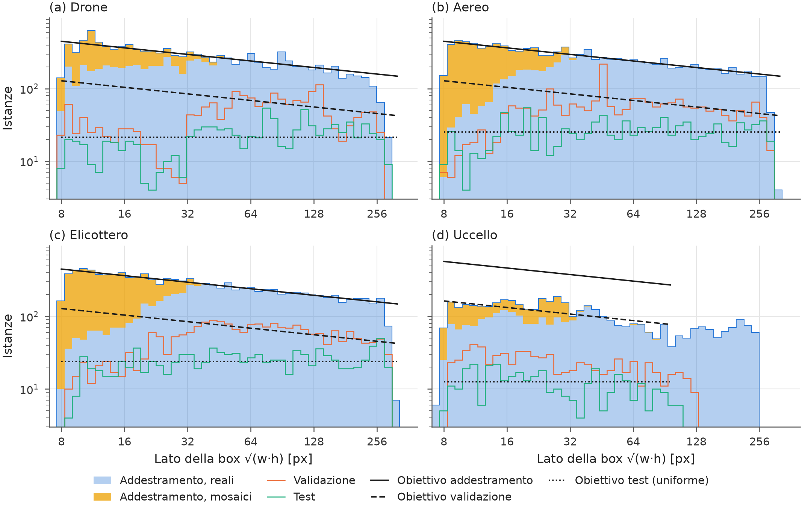
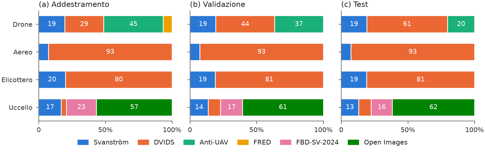
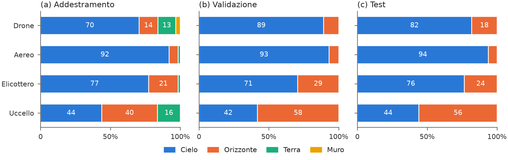
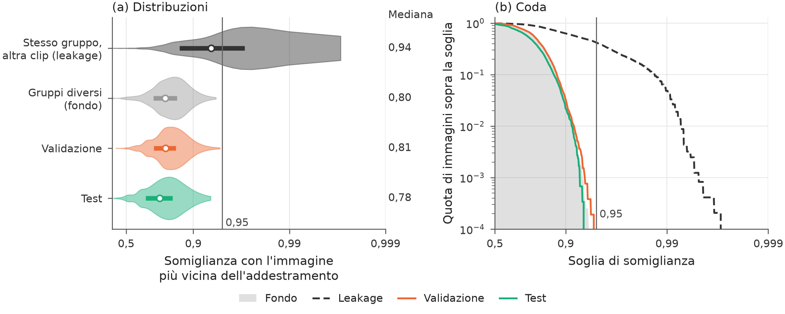
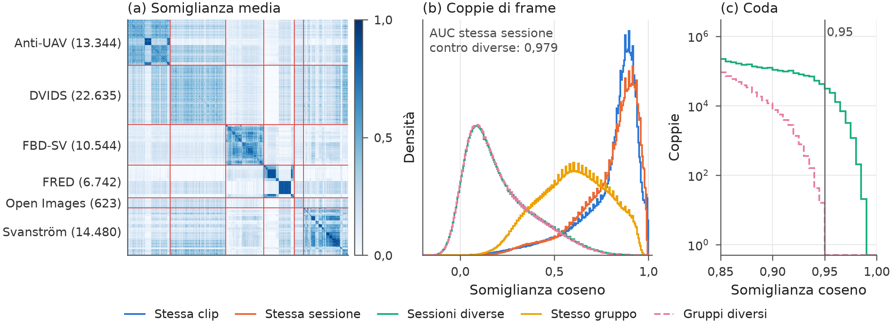
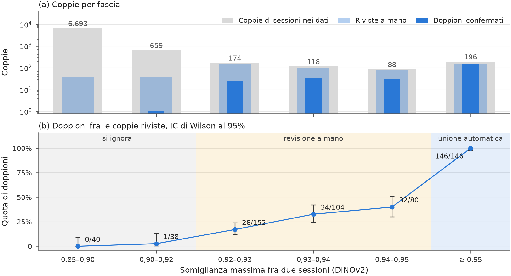
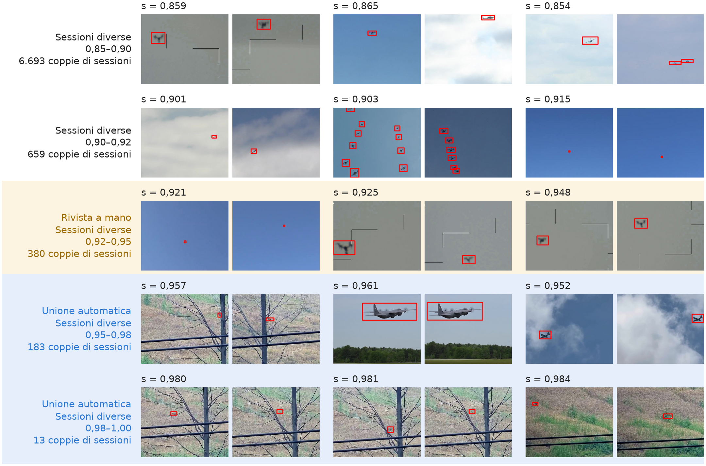

# air-detection

*[English version](README.en.md)*

Dataset per rilevare **droni, aerei, elicotteri e uccelli** da una torretta anti-drone a terra, con una camera RGB
rivolta al cielo e all'orizzonte. È costruito per la tesi (repo `yoloeval`):
- sei fonti pubbliche di oggetti, più due di solo sfondo;
- label riviste a mano in CVAT e poi con una revisione per candidati;
- **allineato al dominio**: val e test solo cielo e orizzonte;
- diviso per ripresa e bilanciato per grandezza dell'oggetto e per fonte.

Il dataset è in `data/output/`, in formato Ultralytics YOLO, ed è **congelato** dal 27/10/2026: non si rigenera e
non si modifica.

| | |
|---|---|
| classi | `0 drone`, `1 airplane`, `2 helicopter`, `3 bird` |
| immagini | 640×512, mai ingrandite |
| split | train 23.062, val 6.132, test 3.469, più 511 immagini di calibrazione int8 |
| istanze per classe | circa 11.700–11.880 in train, circa 1.900–2.260 in val, circa 940–1.120 in test; uccelli: 4.444, 751, 375 |
| grandezza degli oggetti | √(w·h) da 8 a oltre 256 px, più esempi dove l'oggetto è piccolo |

1. [Il dataset](#il-dataset)
2. [Regole](#regole)
3. [Fonti e licenze](#fonti-e-licenze)
4. [Crediti e citazioni](#crediti-e-citazioni)
5. [Procedura](#procedura)
6. [Uso degli strumenti](#uso-degli-strumenti)

## Il dataset

```
data/output/
├── dataset.yaml, calib.yaml      train/val/test e calibrazione int8 per Ultralytics
├── images/{train,val,test,calib}/
├── labels/{train,val,test,calib}/
├── raw/{images,labels}/          train + val + test in una cartella sola, per rifare gli split
├── manifest.csv                  una riga per immagine: split, tipo, gruppo, fonte, clip, frame, scenario, meteo, sorgente
├── fonti_dvids.csv               pagina, autore e licenza di ogni video DVIDS usato
├── fonti_openimages.csv          autore, licenza e pagina di ogni foto di Open Images usata
├── distribuzione, fonti, contesto, leakage (.png, .pdf; leakage.md)
└── README.md                     licenze, legenda dei nomi, come risalire all'origine
```

| split | immagini | reali | mosaici | background |
|---|---|---|---|---|
| train | 23.062 | 19.486 | 526 | 3.050 |
| val | 6.132 | 5.232 | 0 | 900 |
| test | 3.469 | 2.953 | 0 | 516 |
| calib | 511 | 460 | 0 | 51 |

| classe | train | di cui da mosaici | val | test |
|---|---|---|---|---|
| drone | 11.706 | 3.160 | 1.896 | 940 |
| airplane | 11.869 | 3.983 | 2.259 | 1.116 |
| helicopter | 11.879 | 4.427 | 2.201 | 1.061 |
| bird | 4.444 | 1.052 | 751 | 375 |

I nomi dei file dicono il tipo di immagine:
- `R_<gruppo>_<clip>_<n>`: immagine **reale**;
- `M_x<griglia>_<n>`: **mosaico**, solo in train;
- `B_<camera>_<n>`: **background**, senza label.

`<clip>` e `<camera>` sono i primi 8 caratteri dello SHA-1 di `fonte:clip`. La colonna `sorgente` di `manifest.csv` è
il file da cui viene l'immagine, relativo a `data/`.

### Distribuzione delle grandezze



**Figura 1.** *Istanze per lato della box e per classe.*
- **Assi.** In ascissa il lato √(w·h) in pixel, su scala logaritmica, con intervalli larghi circa 1/8 di
  ottava; in ordinata le box per intervallo, anch'esse su scala logaritmica. Le box sotto 8 px sono escluse.
- **Train.** Le aree piene: le box delle immagini reali (blu) e, sopra, quelle dei mosaici (giallo).
- **Validazione e test.** Le linee arancione e verde.
- **Obiettivi** (in nero): train (linea continua) e validazione (tratteggio) sono proporzionali a s^−0,3; il test
  è uniforme sulla scala logaritmica (puntini).
- **Lettura.**
  - Dove l'area sta sotto la linea continua mancano esempi.
  - Dove una linea di val o test oscilla attorno al suo obiettivo, la fascia è coperta.
- **Risultati.**
  - Aerei, elicotteri e droni seguono l'obiettivo del train fino a circa 181 px. Sopra, le fonti hanno pochi
    esempi e Anti-UAV si ferma a circa 256 px.
  - Sotto 32 px l'obiettivo del train si raggiunge con i mosaici, che rimpiccioliscono oggetti grandi.
  - Gli uccelli stanno molto sotto l'obiettivo del train (4.444 box contro 11.700–11.900 delle altre classi); i loro
    obiettivi si fermano a 96 px. Anche la validazione sta sotto il suo obiettivo e segue quello uniforme del test.

### Fonti per split



**Figura 2.** *Composizione per fonte di addestramento (a), validazione (b) e test (c).*
- **Lettura.** Ogni barra è una classe, divisa secondo la quota di box di ogni fonte. I numeri sono percentuali,
  scritte sui segmenti di almeno il 12%. I mosaici contano la fonte delle loro caselle.
- **Risultati.**
  - Le quote dei tre pannelli si somigliano per costruzione: lo split tiene conto del mix di fonti e il train ha
    un tetto per fonte.
  - Gli aerei vengono quasi tutti da DVIDS (93%), gli elicotteri per circa l'80%.
  - I droni di val e test vengono da DVIDS (44–61%), Anti-UAV (20–37%) e Svanström (19%). Nel train, sui box reali:
    Anti-UAV 34%, DVIDS 31%, Svanström 26% e FRED 9%. FRED è solo nel train, e con i mosaici pesa il 6,7%.
  - Gli uccelli di val e test vengono per circa il 60% da Open Images, solo uccelli in volo (filtro SigLIP). Nel train,
    sui box reali: Open Images 52%, FBD-SV 25%, Svanström 18%.

### Contesto



**Figura 3.** *Scenario dello sfondo per split e classe: addestramento (a), validazione (b), test (c).*
- **Lettura.** Come la Figura 2, con lo scenario al posto della fonte. Le quattro categorie sono
  assegnate per clip **[operatore]** e controllate con la tessitura dello sfondo:
  - **cielo**: solo cielo;
  - **orizzonte**: cielo con la linea dell'orizzonte;
  - **terra**: alberi, campi, edifici;
  - **muro**: una parete come sfondo.
- **Risultati.**
  - Val e test contengono solo cielo e orizzonte, il dominio della torretta. L'orizzonte vale il 6–30% per
    classe, il 56–58% per gli uccelli.
  - Nel train terra e muro restano sotto il 25% per classe: 22% per gli uccelli (FBD-SV) e per i droni (FRED e
    terra), circa 2% per aerei ed elicotteri.
  - Quando il meteo sarà annotato (colonna `meteo` del manifest) comparirà come seconda riga.

### Leakage fra gli split



**Figura 4.** *Somiglianza fra split.* Per ogni immagine reale, la somiglianza coseno DINOv2 (ViT-S/14) con
l'immagine reale più vicina del train. L'asse x è in scala −log₁₀(1 − s), che allarga la zona vicina a 1.
- **(a) Distribuzioni.** Violino = distribuzione; pallino = mediana, scritta a destra; barra = primo e terzo
  quartile.
- **(b) Coda.** La quota di immagini sopra ogni soglia di somiglianza, su scala logaritmica. La linea verticale è la soglia dei
  doppioni, 0,95.
- **Riferimenti**, presi dentro il train:
  - "stesso gruppo, altra clip": com'è fatto un leakage vero, mediana 0,935;
  - "gruppi diversi": il fondo, cioè la somiglianza che c'è comunque perché il cielo somiglia al cielo;
    mediana 0,804.
- **Lettura.** Con un leakage, le curve di val e test si sposterebbero verso quella tratteggiata.
- **Risultati.**
  - Validazione (mediana 0,806) e test (0,777) coincidono con il fondo, anche nella coda fra 0,85 e 0,95.
  - Nessuna immagine supera 0,95. In parte è per costruzione, perché le coppie sopra 0,95 stanno nello stesso
    gruppo; la coincidenza con il fondo sotto 0,95 invece no.

### Somiglianza fra riprese



**Figura 5.** *Somiglianza DINOv2 fra tutti i 68.368 frame annotati.*
- **(a) Matrice.** La somiglianza media fra blocchi di frame consecutivi, in ordine di fonte, sessione e clip.
  - Le righe rosse separano le fonti; fra parentesi il numero di frame.
  - L'area di ogni fonte è proporzionale alla radice dei suoi frame, così anche Open Images (1.059) resta visibile.
  - Un blocco scuro sulla diagonale è una ripresa i cui frame si somigliano molto.
- **(b) Coppie di frame.** La distribuzione della somiglianza di tutte le coppie, per tipo:
  - stessa clip;
  - stessa sessione e altra clip;
  - sessioni diverse;
  - stesso gruppo e altra sessione (i doppioni uniti);
  - gruppi diversi.
- **(c) Coda.** Ingrandimento sopra 0,85: il numero di coppie fra sessioni diverse (verde) e fra gruppi diversi
  (rosa, cioè dopo l'unione dei doppioni), su scala logaritmica.
- **Risultati.**
  - Le coppie della stessa sessione (mediana 0,84–0,85) si distinguono bene da quelle di sessioni diverse (0,17):
    l'AUC è 0,979.
  - Le coppie dello stesso gruppo (mediana 0,66) stanno in mezzo: sono riprese ripubblicate o girate di seguito.
  - Fra sessioni diverse ci sono coppie fino a 0,99. Fra gruppi diversi nessuna supera 0,95, perché le sessioni
    sopra soglia sono state unite: la curva rosa si ferma lì.
  - Nella matrice, FRED e FBD-SV formano blocchi a parte (muro e vegetazione); le fonti di cielo e orizzonte
    (Svanström, Anti-UAV, DVIDS, Open Images) si somigliano fra loro.

### La soglia dei doppioni



**Figura 6.** *Taratura della soglia dei doppioni.*
- **Lettura.**
  - Per fascia di somiglianza massima fra due sessioni, la quota di coppie giudicate doppioni a mano
    **[operatore]**.
  - Sopra ogni barra, i doppioni sul totale; la barra d'errore è l'intervallo di Wilson al 95%.
  - A destra della linea tratteggiata, le coppie sopra 0,95.
- **Risultati.** La quota sale da 0/40 sotto 0,90 al 40% fra 0,94 e 0,95; sopra 0,95 è 146/146. Da qui la regola:
  sopra 0,95 le sessioni si uniscono in automatico, fra 0,92 e 0,95 si rivedono.

Doppione vuol dire stessa ripresa (stesso momento, stessa luce e cielo) o stesso girato pubblicato due volte; lo stesso
posto in un altro giorno non lo è.
- **Sopra 0,95:** 146 coppie riviste, tutte doppioni.
- **Fra 0,92 e 0,95:** 336 coppie riviste, 92 doppioni (dal 17% al 40% man mano che la somiglianza sale).
- **Sotto 0,92:** un campione di 78 coppie, 1 doppione.

Tutti i doppioni confermati sono uniti nello stesso gruppo. Le coppie sopra 0,95 delle sessioni aggiunte dopo la
revisione (Anti-UAV del 26/10/2026) sono unite in automatico con la stessa regola. Sono le stesse riprese, quindi non
si cancellano: finiscono nello stesso split. Sotto 0,92 resta solo lo stesso posto in momenti diversi, cioè il leakage
dello sfondo accettato.



**Figura 7.** *Esempi di coppie di frame di sessioni diverse per fascia di somiglianza.*
- **Lettura.**
  - Ogni riga è una fascia: tre coppie scelte a caso (seme fisso), con le box in rosso e la somiglianza sopra
    ogni coppia.
  - A sinistra, quante coppie di sessioni hanno la somiglianza massima nella fascia.
  - In giallo la fascia rivista a mano (0,92–0,95), in blu l'unione automatica (≥ 0,95).
  - In fondo, coppie della stessa clip come riferimento (25°, 50° e 75° percentile).
  - Le coppie con un frame scuro non sono mostrate.
- **Risultati.**
  - Sotto 0,92 le coppie sono cieli simili di riprese diverse.
  - Sopra 0,95 c'è la stessa inquadratura, spesso con lo stesso oggetto pochi secondi dopo.
  - Due frame della stessa clip possono scendere a 0,63 quando l'oggetto o l'inquadratura cambiano: una somiglianza
    bassa non dimostra che due riprese siano diverse.
- **Coppie mai riviste.** Fra 0,92 e 0,95 ci sono 379 coppie di sessioni: 330 riviste, 23 già nello stesso gruppo,
  26 mai riviste. Le 26 vengono tutte dalle sessioni aggiunte dopo la revisione: 22 di Anti-UAV, 4 di Open Images.

### Limiti dichiarati

- **Uccelli sotto-rappresentati.** In cielo o all'orizzonte ce ne sono pochi (Svanström, DVIDS, Open Images).
  FBD-SV-2024 è quasi tutto vegetazione, quindi sta solo nel train e dentro la quota fuori dominio.
- **Droni ad ala fissa esclusi**: troppo pochi per stare in tutti gli split.
- **Oggetti sopra i 181 px** sotto la curva del train, per tutte le classi.
- **Droni in val e test** sotto l'obiettivo (1.896 contro 2.547 e 940 contro 1.273), soprattutto fra 16 e 32 px: i
  video di droni indipendenti sono pochi, e un gruppo non può superare il 15% di una classe né il 75% di una cella.
- **Label dei droni Anti-UAV aggiunti il 26/10/2026**: sono quelle originali del dataset.
- **Leakage dello sfondo accettato**: le fonti con il cielo hanno uno sfondo che si ripete fra riprese diverse, ed è
  accettato perché in esercizio la torretta è fissa.
- Nessun oggetto sotto gli 8 px e nessuna ripresa notturna; niente aerei con la scia di condensa o di fumo.

## Regole

Fissate prima di toccare i dati e aggiornate con le decisioni prese durante la costruzione.

**Formato**
- Tutte le immagini 640×512. Le fonti più grandi si **ritagliano** attorno agli oggetti, senza ridimensionare: i
  pixel delle label sono quelli che vede il modello.
- Label YOLO txt.

**Annotazione**
- Box **aderente** all'oggetto, con la stessa regola per tutte le fonti.
- Tutti gli oggetti visibili delle 4 classi hanno il box, anche negli stormi (uno per uccello) e anche gli uccelli
  posati.
- Pale ed eliche nel box solo se si vedono.
- Oggetti tagliati dal bordo o coperti: box sulla parte visibile.
- Oggetti fuori dalle 4 classi (mongolfiere, alianti, aquiloni): senza label, immagine tenuta.
- Prima revisione: tutte le label in CVAT, anche quelle proposte da un detector o da SAM 2.
- Seconda revisione, per candidati: due detector indipendenti segnalano oggetti senza box, box vuote e classi in
  disaccordo. Nel dubbio su un oggetto senza box o su una classe, il frame si toglie.
- Terza revisione: tutte le immagini reali del dataset in CVAT, una per una, comprese quelle aggiunte dopo. Frame
  notturni tolti; un frame rimasto senza box si toglie.

**Grandezza**: s = √(w·h) in pixel.
- Box sotto i 4 px² tolti.
- Immagini con un box sotto gli 8 px tolte da tutti gli split. Si toglie l'immagine intera, perché togliere solo il
  box lascerebbe un oggetto senza label.

**Dominio**
- Solo riprese diurne, da terra verso il cielo o l'orizzonte.
- Via le riprese da bordo, aria-aria, al chiuso e le scie di fumo o condensa.
- Ogni clip ha uno **scenario**:
  - `cielo`;
  - `orizzonte`: in volo basso, con alberi, colline o edifici dietro;
  - `terra`: fermo o posato, in rullaggio, nell'erba;
  - `muro`: davanti a facciate o cortili.
- **Val e test: solo cielo e orizzonte**, con l'orizzonte intorno al 20%. **Train**: terra e muro al massimo il 25%
  per classe, la stessa quota per tutte le classi, così il modello non lega la classe allo sfondo.
- Droni ad ala fissa esclusi.

**Distribuzione obiettivo**
- La densità in scala logaritmica va come **s^−0,3** tra 8 e 320 px, uguale per tutte le classi, e il totale è
  alzato ×1,2. È una stima: la distribuzione vera del dominio non si conosce.
- La forma ha due motivi:
  - un bersaglio che si avvicina resta a lungo piccolo, ed è da piccolo che le classi si confondono;
  - con la stessa curva per tutte le classi, il modello non può legare la classe alla grandezza.
- Gli uccelli si fermano a 96 px: sopra sono troppo pochi.

**Bilanciamento per split**
- **Train**, in quest'ordine:
  1. quota fuori dominio;
  2. nessuna sessione oltre il 6% di una classe;
  3. nessuna fonte oltre 1,5 volte la sua quota in val e test;
  4. tetto al 70% della curva su quarti d'ottava.

  Gli oggetti piccoli mancanti si compensano con **mosaici**: 2×2, 4×4 o 8×8 ritagli del train ridotti di ×0,5, ×0,25
  o ×0,125, con sfocatura, rumore e JPEG leggeri, mai con box sotto gli 8 px.
  - Le caselle di un mosaico si prendono **a caso dalla stessa mezza ottava** di grandezza, solo da immagini in
    dominio, a turno tra le sessioni.
  - Lo `scale` di Ultralytics non basta: sposta le istanze tra le grandezze ma non ne aggiunge.
- **Val**: il 20% della curva, mai oltre il 20% del materiale in dominio. La fitness di Ultralytics (la scelta di
  `best.pt`) si calcola sul val e deve pesare le grandezze come in esercizio.
- **Test**: uniforme in scala logaritmica, per una misura affidabile a ogni grandezza.
- **Fonti**: in val e test ogni fonte ha la sua quota del materiale in dominio, classe per classe.
- **Background**: circa il 10% di ogni split, da fonti indipendenti (solo cielo e orizzonte, senza oggetti).
- **Mai immagini sintetiche** in val e test.

**Split per gruppo**
- L'unità è la **sessione di ripresa**, cioè stesso posto e stesse condizioni. Le sessioni che si somigliano
  diventano un **gruppo**: doppioni confermati a mano fra le coppie con DINOv2 ≥ 0,92, più ogni altra coppia ≥ 0,95.
- Un gruppo sta tutto in uno split: la stessa ripresa non è mai in due split.
- In val e test un gruppo dà solo i frame in dominio e, se è grande, un sottoinsieme casuale che non superi il 75%
  di nessuna cella dell'obiettivo né il 15% dell'obiettivo di una classe (27/10/2026: prima un gruppo di Anti-UAV
  aveva il 41% dei droni del val). Il resto del gruppo non si usa: non può andare nel train.
- L'assegnazione minimizza la distanza dagli obiettivi, con almeno 2.000 istanze per classe in val e 1.000 in test
  (e mai oltre il 20% del materiale in dominio).
- Un termine di **spreco** (28/10/2026) fa costare i box che un gruppo perde quando va in val o test, con i droni ×4.
  Senza questo termine lo split sceglieva gruppi grandi e buttava 7.846 droni; con il termine ne butta 530 (2%).

**Fonti**
- Solo licenze aperte (pubblico dominio, CC0, CC BY, Apache, MIT), verificate prima del download.
- Due eccezioni dichiarate: FBD-SV-2024 e Skyfinder (sotto).

## Fonti e licenze

| fonte | cosa dà | licenza | link |
|---|---|---|---|
| Svanström et al., Data in Brief 2021 | video 640×512 delle 4 classi | CC0 1.0 | [GitHub](https://github.com/DroneDetectionThesis/Drone-detection-dataset) |
| FRED, Magrini et al., ACM MM 2025 | droni | Apache 2.0 | [Hugging Face](https://huggingface.co/datasets/GabrieleMagrini/FRED) |
| Anti-UAV300 (RGB), Jiang et al., IEEE TMM 2021 | droni | MIT | [GitHub](https://github.com/ZhaoJ9014/Anti-UAV) |
| DVIDS | aerei, elicotteri, droni, uccelli | pubblico dominio, video per video | [dvidshub.net](https://www.dvidshub.net) |
| Open Images V7, Kuznetsova et al., IJCV 2020 | uccelli in cielo | annotazioni CC BY 4.0, immagini CC BY 2.0 | [Open Images](https://storage.googleapis.com/openimages/web/index.html) |
| FBD-SV-2024, Sun et al., Scientific Data 2025 | uccelli | **solo ricerca, non commerciale** ⚠ | [figshare](https://figshare.com/articles/dataset/FBD-SV-2024/27377595) |
| Clouds-1500, Mendeley Data 2023 | background | CC BY 4.0 | [Mendeley](https://data.mendeley.com/datasets/2khchjbgzr/2) |
| SkyFinder, Mihail et al., WACV 2016 (copia di Nice e Wijnands 2019) | background | CC BY 4.0 sul record Zenodo, ma immagini di webcam AMOS di terzi ⚠ | [Zenodo 2562396](https://zenodo.org/records/2562396) |

⚠ FBD-SV-2024 e Skyfinder sono usati perché il dataset serve a una tesi di ricerca. Sono separabili dalla colonna
`fonte` di `manifest.csv` e vanno tolti prima di pubblicare il dataset o di usarlo a fini commerciali.

Attribuzione:
- citare gli articoli delle fonti;
- per DVIDS: "The appearance of U.S. Department of War (DoW) visual information does not imply or constitute DoW
  endorsement.";
- per Anti-UAV: riportare copyright e licenza MIT;
- per Open Images: autore e link di ogni foto (CC BY 2.0), in `data/output/fonti_openimages.csv`.

Dettagli, link di download e frase di attribuzione in `data/output/README.md`.

## Crediti e citazioni

Il dataset esiste grazie a queste fonti. Chi lo usa deve citare gli articoli e rispettare le licenze.

| fonte | cosa abbiamo usato | come citarla e licenza |
|---|---|---|
| Svanström, Alonso-Fernandez, Englund | 284 video RGB 640×512 | `svanstrom2021dataset`; dati CC0 1.0 (DOI dei dati 10.5281/zenodo.5500576), articolo CC BY 4.0 |
| FRED, Magrini et al. | 10 sequenze RGB di droni | `magrini2025fred`; Apache 2.0, riportare la licenza |
| Anti-UAV, Jiang et al. | registrazioni RGB di Anti-UAV300 | `jiang2023antiuav` (online 2021, vol. 25 del 2023); MIT, riportare copyright e licenza |
| Open Images, Kuznetsova et al. | 1.059 ritagli con uccelli in volo | `kuznetsova2020openimages`; annotazioni CC BY 4.0 (Google), immagini CC BY 2.0: autore e link in `data/output/fonti_openimages.csv` |
| FBD-SV-2024, Sun et al. | 483 video di uccelli | `sun2025fbdsv`; dati su figshare (DOI 10.6084/m9.figshare.27377595, CC BY 4.0 secondo DataCite), ma il readme del dataset dice "for learning and research purposes only, not for commercial use" ⚠ |
| Clouds-1500, Arrais et al. | immagini di background | `arrais2023clouds1500`; CC BY 4.0 |
| SkyFinder, Mihail et al. | immagini di background | `mihail2016sky`; scaricate dalla copia di Nice e Wijnands (2019), "Dataset for: Sky pixel detection in outdoor imagery using an adaptive algorithm and machine learning", Zenodo, doi:10.5281/zenodo.2562396, CC BY 4.0 (cartella `GSV` esclusa); immagini da webcam AMOS, termini di AMOS non verificati ⚠ |
| DVIDS | video di pubblico dominio di aerei, elicotteri, droni e uccelli | nessuna citazione; frase obbligatoria: "The appearance of U.S. Department of War (DoW) visual information does not imply or constitute DoW endorsement."; elenco dei video con autore in `data/output/fonti_dvids.csv` |

```bibtex
@article{svanstrom2021dataset,
  author  = {Svanstr{\"o}m, Fredrik and Alonso-Fernandez, Fernando and Englund, Cristofer},
  title   = {A dataset for multi-sensor drone detection},
  journal = {Data in Brief},
  volume  = {39},
  pages   = {107521},
  year    = {2021},
  doi     = {10.1016/j.dib.2021.107521}
}

@inproceedings{magrini2025fred,
  author    = {Magrini, Gabriele and Marini, Niccol{\`o} and Becattini, Federico and Berlincioni, Lorenzo and
               Biondi, Niccol{\`o} and Pala, Pietro and Del Bimbo, Alberto},
  title     = {{FRED}: The Florence {RGB}-Event Drone Dataset},
  booktitle = {Proceedings of the 33rd ACM International Conference on Multimedia},
  pages     = {13170--13176},
  year      = {2025},
  doi       = {10.1145/3746027.3758271}
}

@article{jiang2023antiuav,
  author  = {Jiang, Nan and Wang, Kuiran and Peng, Xiaoke and Yu, Xuehui and Wang, Qiang and Xing, Junliang and
             Li, Guorong and Guo, Guodong and Ye, Qixiang and Jiao, Jianbin and Zhao, Jian and Han, Zhenjun},
  title   = {Anti-{UAV}: A Large-Scale Benchmark for Vision-Based {UAV} Tracking},
  journal = {IEEE Transactions on Multimedia},
  volume  = {25},
  pages   = {486--500},
  year    = {2023},
  doi     = {10.1109/TMM.2021.3128047}
}

@article{kuznetsova2020openimages,
  author  = {Kuznetsova, Alina and Rom, Hassan and Alldrin, Neil and Uijlings, Jasper and Krasin, Ivan and
             Pont-Tuset, Jordi and Kamali, Shahab and Popov, Stefan and Malloci, Matteo and Kolesnikov, Alexander and
             Duerig, Tom and Ferrari, Vittorio},
  title   = {The Open Images Dataset {V4}: Unified Image Classification, Object Detection, and Visual Relationship
             Detection at Scale},
  journal = {International Journal of Computer Vision},
  volume  = {128},
  pages   = {1956--1981},
  year    = {2020},
  doi     = {10.1007/s11263-020-01316-z}
}

@article{sun2025fbdsv,
  author  = {Sun, Zi-Wei and Hua, Ze-Xi and Li, Heng-Chao and Qi, Zhi-Peng and Li, Xiang and Li, Yan and
             Zhang, Jin-Chi},
  title   = {{FBD-SV-2024}: Flying Bird Object Detection Dataset in Surveillance Video},
  journal = {Scientific Data},
  volume  = {12},
  pages   = {530},
  year    = {2025},
  doi     = {10.1038/s41597-025-04872-6}
}

@misc{arrais2023clouds1500,
  author    = {Arrais, Juliana Marian and Cerentini, Allan and Juncklaus, Bruno and Polli, Marco and Chaves, Thiago and
               von Wangenheim, Aldo and Ricci, Gilberto and Mantelli, Sylvio and Silva, Caio and Rosa, Gabriel},
  title     = {Clouds-1500},
  year      = {2023},
  publisher = {Mendeley Data},
  version   = {2},
  doi       = {10.17632/2khchjbgzr.2}
}

@inproceedings{mihail2016sky,
  author    = {Mihail, Radu Paul and Workman, Scott and Bessinger, Zach and Jacobs, Nathan},
  title     = {Sky Segmentation in the Wild: An Empirical Study},
  booktitle = {IEEE Winter Conference on Applications of Computer Vision (WACV)},
  pages     = {1--6},
  year      = {2016},
  doi       = {10.1109/WACV.2016.7477637}
}
```

## Procedura

Le operazioni fatte, in ordine. Ogni passo ha la sua cartella e legge solo i passi prima.
**[operatore]** = una persona guarda dei fogli numerati e scrive un file di testo, che il passo dopo legge.

**Per ogni fonte**, in `data/input/<fonte>/`:

1. **Download.**
   - Video e label di Svanström.
   - Di FRED solo il blocco RGB + label degli zip, con richieste HTTP a intervalli: niente dati a eventi.
   - FBD-SV-2024 e Anti-UAV300 dai mirror.
   - DVIDS con la ricerca nell'API e la sola licenza "PUBLIC DOMAIN".
   - Open Images: annotazioni e liste ufficiali con lo sha256 (`openimages/0_raw/scarica.sh`), immagini dal bucket
     pubblico CVDF.
2. **Selezione delle riprese** **[operatore]**.
   - Svanström: 341 clip dai tagli di scena e 112 sessioni, ricostruite sui fogli.
   - FRED: fuori le sequenze al chiuso e notturne.
   - DVIDS: tratti di ±5 s dove il detector vede un velivolo. Fuori le riprese da bordo, aria-aria e a terra, poi
     fumo, scala di grigi e visori notturni; scarti in `0_raw/esclusi.txt`, `fumo.txt`, `grigi.txt`, `verdi.txt`.
   - Open Images: solo foto con uccelli individuali (niente box di gruppo, raffigurazioni o "aircraft" generico),
     classi Bird, Eagle, Falcon, Raven e Magpie, sfondo di cielo o orizzonte. Un filtro SigLIP tiene solo gli
     uccelli in volo (probabilità ≥ 0,7 o scena più probabile); 10 scarti a mano in `5_box/scarti_volo.txt`.
   - DVIDS, dal giro 12 (28/10/2026): al massimo 40 frame per video, 1 al secondo (`frame --per-video 40`).
3. **Frame e ritagli 640×512** attorno agli oggetti (FRED, DVIDS, Anti-UAV, FBD, Open Images); Svanström è già
   640×512. Anti-UAV: un frame ogni 25, più quelli a metà strada per i droni sopra i 32 px (26/10/2026, al massimo
   30 per video).
4. **Quasi-duplicati** dentro ogni clip: dHash a 16 bit del ritaglio sul bersaglio, più posizione e grandezza del
   box. Di Svanström resta il 17% dei frame.
5. **Box proposti**:
   - Svanström: contrasto locale e SAM 2 con un punto;
   - FRED: detector sul cielo e sfondo fermo nei cortili;
   - DVIDS: detector;
   - FBD, Anti-UAV e Open Images: box originali.

   Poi la **preselezione**: classe del video per DVIDS, via i primi piani, la notte, i box sotto 4 px², i box doppi
   e la stella del logo DVIDS.
6. **Revisione in CVAT** di tutti i frame tenuti **[operatore]**, con un secondo controllo a campione (1 frame
   ogni 10). Rientro in `5_box/manuale/`.
7. **Sessioni** di ogni fonte: date e ore dei file, poi gruppi DINOv2 delle clip rivisti sui fogli.

**Su tutte le fonti**, in `data/intermediate/`:

8. `9_split`: tabella dei 68.368 frame annotati (81.980 box) ed embedding DINOv2 ViT-S/14 di ogni frame.
9. `10_doppioni`: doppioni fra sessioni, rivisti sui fogli **[operatore]**.
   - Sopra 0,95: 146 coppie, tutte doppioni (`unire.txt`).
   - Taratura: 160 coppie a campione fra 0,85 e 0,95 (`taratura/`); doppioni solo da 0,92 in su.
   - Revisione completa delle altre 254 coppie fra 0,92 e 0,95 (`fascia_092/`).
   - Le 26 coppie fra 0,92 e 0,95 di sessioni aggiunte dopo (`fascia_092_b/`): 18 doppioni (13 notturne).
   - In tutto 93 doppioni sotto 0,95, quasi tutti FBD (camere fisse).
10. `11_gruppi`: sessioni note, doppioni rivisti e ogni altra coppia ≥ 0,95 → **1.566 gruppi** (da 1.751 sessioni).
11. `12_scenario`: scenario di ogni clip **[operatore]**.
    - Provini di 5 frame per clip.
    - Proposte in `proposte/`, correzioni dell'utente in `correzioni.csv`, controllo con la tessitura dello sfondo
      (`metrica.csv`).
    - Le clip con droni ad ala fissa sono segnate qui.
12. `13_revisione`: revisione delle label per candidati **[operatore]**.
    - Due detector indipendenti su tutti i frame (`pred.pkl`).
    - 4.277 candidati in fogli da 24.
    - Decisioni in `decisioni/`: 632 box aggiunte, 677 label vuote tolte, 63 classi cambiate.
13. `14_background`: Clouds-1500 e Skyfinder.
    - Ritagli 640×512 senza ingrandire.
    - Via quelli dove il detector vede un oggetto (confidenza 0,1).
    - Quasi-duplicati per camera (DINOv2 < 0,95).
    - Revisione **[operatore]**: 17 tolti.
    - Circa il 10% per split, a camere intere.
14. `15_dataset`: la tabella dei frame.
    - `tabella`: scenario, ala fissa tolta, label corrette in `label/`, via i frame dubbi e quelli con box sotto 8 px.
15. `16_cvat`: revisione completa in CVAT **[operatore]** (`tools/cvat_output.py`).
    - Tutte le immagini reali del primo export (26/10/2026): 655 box cambiati, 1.000 frame notturni di Anti-UAV
      cancellati, 213 frame rimasti senza box.
    - Poi, a ogni nuovo split, i frame non ancora rivisti (`nuovi_<giro>.csv`): 2.597, 1.400 e 893 frame; il 27/10/2026
      785 frame rivisti su fogli (giro `17d`), con 19 frame di una ripresa passati da drone a helicopter.
    - Label corrette in `label/`, copie: le label delle fonti restano quelle originali.
16. `17_dataset`: il dataset.
    - `rivisti`: le label della revisione; via i frame cancellati o vuoti, il gruppo notturno, i frame bui
      (grigio medio < 30) e le clip dove la revisione ha tolto un box.
    - `split`: gruppi in train, val e test (1.000 ordini casuali in parallelo, si tiene il migliore). Prima i frame
      rivisti; test al massimo metà della validazione per classe; quota di orizzonte e fonti come nel bacino.
    - `train`: quote e tetti; si tolgono prima i frame non rivisti.
    - `mosaici`: dalla stessa mezza ottava, solo da frame rivisti, con il tetto per fonte del train.
    - `export`: in `data/output/`, con hardlink delle immagini, label nel nuovo ordine delle classi, calib, manifest,
      README e figure.

## Uso degli strumenti

```bash
python3 -m venv .venv && .venv/bin/pip install -r requirements.txt
cp .env.example .env                     # poi compilare: pesi dei modelli, credenziali CVAT
export NO_PROXY=localhost,127.0.0.1      # CVAT locale, se c'è un proxy di sistema
```

`.env` dice quali modelli usare. I pesi stanno in `models/`, fuori da git:
- `DETECTOR_PESI`: detector delle proposte, pesi privati, mai in repo;
- `SAM_PESI`: SAM 2.1, scaricato da Ultralytics al primo uso;
- `REVIEW_PESI`: il secondo detector della revisione per candidati.

Gli script si lanciano dalla radice della repo con `.venv/bin/python`. I parametri di ogni passo sono in `--help`.

```
models/             pesi .pt (fuori da git)
data/
├── input/          fonti, una cartella per passo: svanstrom, fred, dvids, anti_uav, fbd_sv, openimages,
│                   clouds1500, skyfinder, background (le scelte, in hardlink)
├── intermediate/   passi su tutte le fonti: 9_split … 17_dataset (deprecated_*: passi superati, da cancellare)
└── output/         il dataset finale (congelato)
```

`input/` e `intermediate/` restano fuori da git, `output/` è versionata.

### Svanström: `tools/svanstrom.py`

```bash
python tools/svanstrom.py --step frames        # download, frame e label .mat -> 1_frame
python tools/svanstrom.py --step tagli         # candidati taglio di scena -> 2_sequenze/candidati  [operatore: tagli.txt]
python tools/svanstrom.py --step sequenze      # tagli veri -> 2_sequenze/sequenze.csv
python tools/svanstrom.py --step sessioni      # proposta di sessioni -> 3_sessioni/fogli  [operatore: correzioni.txt]
python tools/svanstrom.py --step unione        # proposta + correzioni -> 3_sessioni/sessioni.csv
python tools/svanstrom.py --step box           # box a contrasto, clip pulite e difficili -> 4_box
python tools/svanstrom.py --step sam           # SAM 2 con un punto sulle clip difficili
python tools/svanstrom.py --step fogli_sam     # fogli di controllo dei box SAM
python tools/svanstrom.py --step cvat          # task CVAT 'box', job di clip intere  [operatore: revisione]
python tools/svanstrom.py --step cvat_import   # zip YOLO di CVAT in 4_box/cvat_zip -> 4_box/manuale
python tools/svanstrom.py --step meteo         # meteo per clip (SigLIP) -> task CVAT 'meteo'  [operatore]
python tools/svanstrom.py --step meteo_import  # -> 5_meteo/meteo.csv
python tools/svanstrom.py --step dedup         # quasi-duplicati dentro la clip -> 6_dedup/tenuti.csv
python tools/svanstrom.py --step fogli_dedup   # fogli di controllo della deduplica
python tools/svanstrom.py --step conta         # istanze per classe e fascia -> 7_conteggio
```

### FRED: `tools/fred.py`

```bash
python tools/fred.py --step label              # solo le label di tutte le sequenze -> 0_raw
python tools/fred.py --step anteprima          # un frame per sequenza, per togliere le indoor  [operatore]
python tools/fred.py --step frame --seq 107 210  # blocco RGB + label -> 1_frame
python tools/fred.py --step annotati --seq ...   # via i frame senza box -> 2_annotati
python tools/fred.py --step dedup --seq ...      # quasi-duplicati -> 3_dedup
python tools/fred.py --step ritaglio --seq ...   # 640x512 -> 4_ritagli
python tools/fred.py --step sam | yolo | movimento --seq ...                    # box proposti -> 5_box/<metodo>
python tools/fred.py --step fogli_sam | fogli_yolo | fogli_movimento --seq ...  # fogli di controllo
python tools/fred.py --step proposte --seq ...   # detector sul cielo, movimento sui cortili -> 5_box/proposte
python tools/fred.py --step sessioni           # sessioni per giorno e ora -> 6_sessioni
python tools/fred.py --step conta              # -> 7_conteggio
python tools/fred.py --step cvat | cvat_import # revisione in CVAT -> 5_box/manuale
```

### FBD-SV-2024, Anti-UAV, DVIDS: `tools/extra_sources.py`

```bash
python tools/extra_sources.py --fonte fbd --step frame       # video + XML -> 1_frame
python tools/extra_sources.py --fonte antiuav --step frame   # immagini dal mirror -> 1_frame
python tools/extra_sources.py --fonte antiuav --step frame_extra  # droni > 32 px fra i frame usati -> 8_extra
python tools/extra_sources.py --fonte dvids --step cerca --classe airplane     # API DVIDS -> 0_raw/candidati.csv
python tools/extra_sources.py --fonte dvids --step info --classe airplane      # licenza, autore, mp4 -> 0_raw/video.csv
python tools/extra_sources.py --fonte dvids --step anteprima --classe airplane # un frame ogni 10 s
python tools/extra_sources.py --fonte dvids --step doppioni  # video ripubblicati con un altro id
python tools/extra_sources.py --fonte dvids --step scegli    # tratti con un velivolo in cielo -> 0_raw/tratti.csv
python tools/extra_sources.py --fonte dvids --step fogli [--grandezza 96 | --minimo 48]  # [operatore: scartiN.txt]
python tools/extra_sources.py --fonte dvids --step escludi --fogli fogli_trattiN --scarti data/input/dvids/0_raw/scartiN.txt
python tools/extra_sources.py --fonte dvids --step frame --classe airplane [--secondi 600]  # 5 fps + detector -> 1_frame
python tools/extra_sources.py --fonte dvids --step fogli_fumo | fogli_grigi | fogli_verdi  # [operatore]
python tools/extra_sources.py --fonte dvids --step fumo | grigi | verdi --fogli <cartella> --scarti <file>
python tools/extra_sources.py --fonte <fonte> --step catena    # annotati, dedup, ritaglio, proposte
python tools/extra_sources.py --fonte <fonte> --step sessioni  # gruppi DINOv2 delle clip -> 6_sessioni
python tools/extra_sources.py --fonte <fonte> --step conta | cvat | cvat_import
python tools/preselection.py      # preselezione su tutte le fonti -> 5_box/preselezione (dopo ogni catena)
python tools/sample.py --step fogli --nome N --fonti dvids:70 fred:20   # campione per stimare il lavoro in CVAT
python tools/sample.py --step stima --nome N
```

### Open Images: `tools/openimages.py`

```bash
data/input/openimages/0_raw/scarica.sh              # annotazioni e liste, con sha256 e data
python tools/openimages.py --step candidati         # foto con uccelli individuali e piccoli -> 1_candidati.csv
python tools/openimages.py --step immagini          # bucket pubblico CVDF -> 2_immagini
python tools/openimages.py --step ritagli           # 640x512 sul cielo -> 4_ritagli, 5_box/manuale, 5_box/ritagli.csv
python tools/openimages.py --step volo              # SigLIP: solo uccelli in volo, box doppi tolti -> 5_box/volo.csv
```

Giro 2 (28/10/2026): `candidati --lato 0.3`, `ritagli --max-px 256`, poi `volo`. Se il proxy dà errore verso Hugging
Face, `HF_HUB_OFFLINE=1` usa il modello in cache.

### Background: `tools/background.py`

```bash
python tools/background.py --fonte clouds1500 --step ritagli   # 640x512 sulla fascia cielo-orizzonte -> 1_ritagli
python tools/background.py --fonte clouds1500 --step detector  # via i ritagli con un oggetto -> 2_detector
python tools/background.py --fonte clouds1500 --step dedup     # quasi-duplicati per camera -> 3_dedup
python tools/background.py --fonte clouds1500 --step fogli     # tenuti ed esclusi a campione  [operatore]
python tools/background.py --step split                        # ~10% per split -> intermediate/14_background
python tools/background.py --step raccolta                     # scelte in hardlink -> input/background/0_raw
```

Stessi passi con `--fonte skyfinder`.

### Su tutte le fonti

```bash
python tools/split.py --step frame               # frame annotati di tutte le fonti -> 9_split/frame.csv
python tools/split.py --step embedding           # DINOv2 ViT-S/14 per frame -> 9_split/embedding_s.npy
python tools/split.py --step somiglianze         # grafico su un campione
python tools/split.py --step anteprima [--fasce 0.95 0.99 1.01]  # coppie di sessioni diverse per fascia
python tools/split.py --step doppioni            # coppie >= 0,95 da rivedere -> 10_doppioni  [operatore: unire.txt]
python tools/split.py --step taratura            # campione per fascia 0,85-0,95 -> 10_doppioni/taratura  [operatore: stessa_sessione.txt]
python tools/split.py --step esito_taratura      # fogli colorati con i giudizi degli operatori
python tools/split.py --step stima_soglia        # quota di doppioni per fascia -> taratura/stima.csv
python tools/split.py --step revisione_fascia    # tutte le coppie 0,92-0,95 non giudicate -> 10_doppioni/fascia_092  [operatore]
python tools/split.py --step revisione_nuove     # coppie 0,92-0,95 delle sessioni aggiunte -> 10_doppioni/fascia_092_b  [operatore]
python tools/split.py --step gruppi              # -> 11_gruppi/gruppi.csv
python tools/split.py --step somiglianze_gruppi  # figura somiglianze -> docs/figure (nomi it_<nome>, en_<nome>)
python tools/split.py --step soglia              # pannello delle coppie per fascia -> docs/figure
python tools/split.py --step figure              # taratura della soglia -> docs/figure
python tools/scenario.py --step fogli            # provini per clip -> 12_scenario/fogli  [operatore: proposte/]
python tools/scenario.py --step metrica          # tessitura dello sfondo attorno alle box -> 12_scenario/metrica.csv
python tools/review.py --step predizioni         # due detector su tutti i frame -> 13_revisione/pred.pkl
python tools/review.py --step candidati          # -> 13_revisione/candidati.csv
python tools/review.py --step fogli              # -> 13_revisione/fogli  [operatore: decisioni/]
python tools/dataset.py --step tabella           # -> 15_dataset/frame.csv, label/, esclusi.csv
python tools/cvat_output.py --step carica        # dataset in CVAT, progetto output_26ott  [operatore: revisione]
python tools/cvat_output.py --step importa       # -> 16_cvat/frame.csv, modifiche.csv, label/
python tools/dataset.py --step rivisti           # -> 17_dataset/frame.csv, esclusi.csv
python tools/dataset.py --step split             # -> 17_dataset/split.csv (20 processi)
python tools/dataset.py --step train             # -> 17_dataset/train.csv, tolti.csv
python tools/cvat_output.py --step carica_nuovi --giro 17b   # frame non rivisti -> progetto nuovi_17  [operatore]
python tools/cvat_output.py --step importa_nuovi --giro 17b  # -> 16_cvat/nuovi_17b.csv; poi di nuovo rivisti
python tools/dataset.py --step mosaici           # -> 17_dataset/mosaici/, mosaici.csv
python tools/dataset.py --step export            # -> data/output (si rifiuta se esiste già)
python tools/dataset.py --step figure            # distribuzione, fonti, contesto, leakage -> docs/figure e data/output
python tools/distributions.py                    # grandezze disponibili e scale di Ultralytics -> docs/figure
```

### Codice

| file | contenuto |
|---|---|
| `tools/common.py` | classi, fasce, deduplica, proposta di sessioni, client CVAT, detector |
| `tools/pipeline.py` | catena comune delle fonti aggiunte: annotati, dedup, ritaglio, box proposti, conteggio, CVAT |
| `tools/svanstrom.py`, `fred.py`, `extra_sources.py`, `openimages.py`, `background.py` | una fonte ciascuno |
| `tools/preselection.py`, `sample.py` | preselezione prima di CVAT, campioni per stimare la revisione |
| `tools/split.py` | tabella dei frame, embedding, doppioni, gruppi, figure della soglia |
| `tools/scenario.py`, `review.py` | scenario per clip e revisione delle label per candidati |
| `tools/cvat_output.py` | revisione completa in CVAT: carica il dataset e i frame nuovi, importa le correzioni |
| `tools/dataset.py` | tabella finale, split, train, mosaici, export, figure del dataset |
| `tools/distributions.py`, `plots.py` | curva obiettivo e stile dei grafici |
| `docs/dataset_readme.md` | modello del README di `data/output` (scritto dall'export) |
| `.env.example` | quali modelli usare e credenziali CVAT, da copiare in `.env` |
