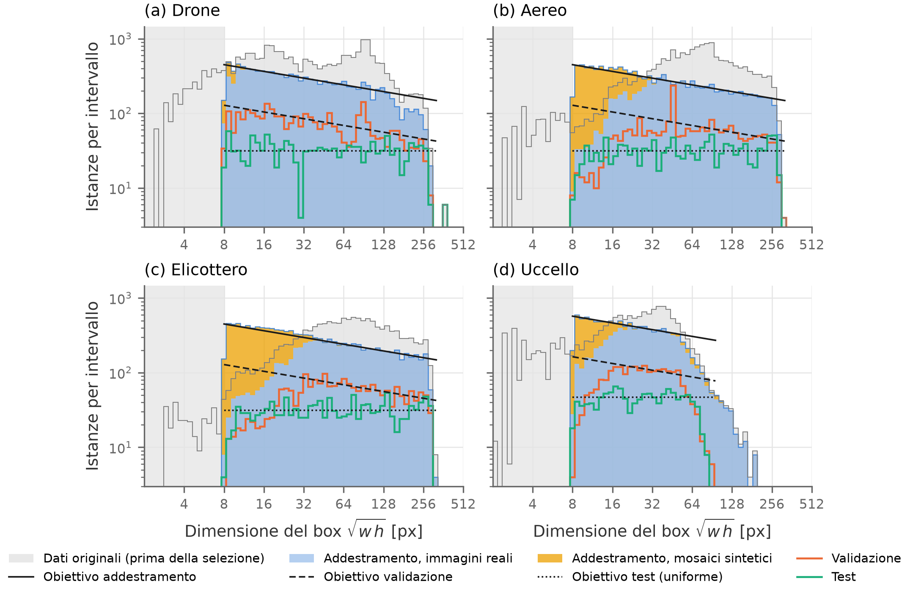
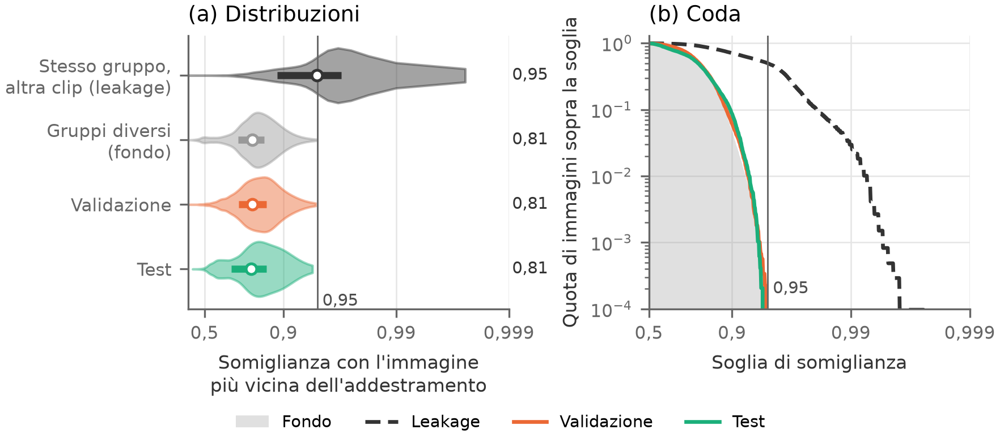
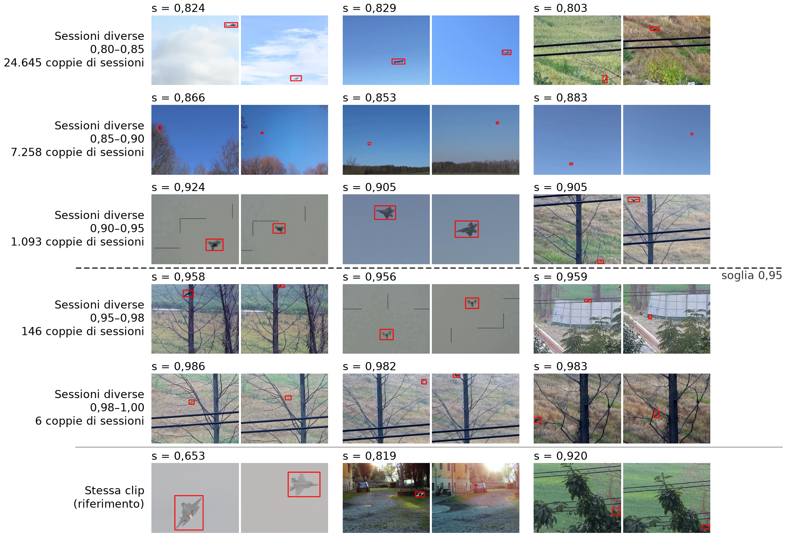

# air-detection

*[English version](README.en.md)*

Dataset per rilevare **droni, aerei, elicotteri e uccelli** da una torretta anti-drone a terra, con una camera RGB
rivolta al cielo. Costruito per la tesi (repo `yoloeval`) da sei fonti pubbliche, rivisto a mano in CVAT, diviso per
ripresa e bilanciato per grandezza dell'oggetto. Il dataset finale è in `data/output/`, in formato Ultralytics YOLO, ed
è **congelato** dal 23/10/2026: non si rigenera e non si modifica.

| | |
|---|---|
| classi | `0 drone`, `1 airplane`, `2 helicopter`, `3 bird` |
| immagini | 640×512, mai ingrandite |
| split | train 30.579, val 9.013, test 5.165, più 512 immagini di calibrazione int8 |
| istanze per classe | ≥ 10.000 in train, ≥ 2.000 in val, ≥ 1.000 in test |
| grandezza degli oggetti | √(w·h) da 8 a oltre 256 px, più esempi dove l'oggetto è piccolo |

1. [Il dataset](#il-dataset)
2. [Regole](#regole)
3. [Fonti e licenze](#fonti-e-licenze)
4. [Procedura](#procedura)
5. [Uso degli strumenti](#uso-degli-strumenti)

## Il dataset

```
data/output/
├── dataset.yaml, calib.yaml      train/val/test e calibrazione int8 per Ultralytics
├── images/{train,val,test,calib}/
├── labels/{train,val,test,calib}/
├── raw/{images,labels}/          train + val + test in una cartella sola, per rifare gli split
├── manifest.csv                  una riga per immagine: split, tipo, gruppo, fonte, clip, frame, file sorgente
├── fonti_dvids.csv               pagina, autore e licenza di ogni video DVIDS usato
├── distribuzione.{png,pdf,md}, leakage.{png,pdf,md}
└── README.md                     licenze, legenda dei nomi, come risalire all'origine
```

| split | immagini | reali | mosaici | background |
|---|---|---|---|---|
| train | 30.579 | 26.580 | 949 | 3.050 |
| val | 9.013 | 8.113 | 0 | 900 |
| test | 5.165 | 4.649 | 0 | 516 |
| calib | 512 | 461 | 0 | 51 |

| classe | train | di cui da mosaici | val | test |
|---|---|---|---|---|
| drone | 11.304 | 475 | 3.077 | 1.419 |
| airplane | 12.128 | 4.334 | 2.275 | 1.367 |
| helicopter | 12.423 | 5.169 | 2.173 | 1.372 |
| bird | 11.142 | 3.223 | 2.248 | 1.246 |

I nomi dei file dicono il tipo di immagine:
- `R_<gruppo>_<clip>_<n>`: immagine **reale**;
- `M_x<griglia>_<n>`: **mosaico**, solo in train;
- `B_<camera>_<n>`: **background**, senza label.

`<clip>` e `<camera>` sono i primi 8 caratteri dello SHA-1 di `fonte:clip`. La colonna `sorgente` di `manifest.csv` è
relativa a `data/` com'era prima del riordino delle cartelle: oggi va letta sotto `data/input/`, e sotto
`data/intermediate/` al posto di `aggregati/`.

### Distribuzione delle grandezze



Istanze per grandezza e classe:
- **blu**: train reale;
- **giallo**: mosaici;
- **linee colorate**: val e test;
- **ombra grigia**: tutti i dati disponibili prima della selezione;
- **nero**: gli obiettivi.

Errore di ogni split rispetto al suo obiettivo, per mezza ottava (tabelle in `data/output/distribuzione.md`):
- **Train**: segue l'obiettivo entro il 5–10%.
- **Test**: segue l'obiettivo entro il 7–16%.
- **Val**: è sotto la curva sugli oggetti piccoli di aerei, elicotteri e uccelli (errore 35–37%), perché lì i dati
  reali non bastano e in val non si usano immagini sintetiche.

### Leakage fra gli split



Per ogni immagine di val e test, la somiglianza DINOv2 con l'immagine più simile del train. Il confronto è con due
riferimenti presi dentro il train:
- **stesso gruppo e altra clip**: com'è fatto un leakage vero, mediana 0,954;
- **gruppi diversi**: il fondo, perché il cielo somiglia sempre al cielo; mediana 0,819.

Val (mediana 0,820) e test (0,818) coincidono con il fondo. Nessuna immagine di val o test supera 0,95.

### La soglia 0,95



Coppie di frame di sessioni diverse per fascia di somiglianza coseno DINOv2, tre per fascia, scelte a caso; in fondo
coppie della stessa clip come riferimento.
- Sopra 0,95 sono la stessa scena: stesso posto, stessa camera, spesso lo stesso girato. Le 146 coppie di sessioni
  sopra soglia sono state riviste a mano e tutte unite nello stesso gruppo.
- Già fra 0,90 e 0,95 compaiono lo stesso posto e la stessa camera in giorni diversi: è il leakage dello sfondo,
  accettato.
- Due frame della stessa clip possono scendere a 0,65 quando l'oggetto cambia molto: una somiglianza bassa non
  dimostra che due riprese siano diverse.

Il pannello quindi giustifica 0,95 come soglia dei **doppioni** (stessa ripresa), non come confine fra riprese uguali e
diverse. La prova che gli split sono separati è la figura del leakage.

### Limiti dichiarati

- Val ha pochi aerei, elicotteri e uccelli sotto i 16 px: i dati reali non bastano.
- I droni piccoli di val e test vengono da pochi voli: 5–6 gruppi per fascia sotto i 32 px.
- Uccelli sopra i 96 px solo in train: troppo pochi per misurarli.
- Le fonti con il cielo hanno uno sfondo che si ripete fra riprese diverse. Questo leakage dello sfondo è accettato,
  perché in esercizio la torretta è fissa.
- Nessun oggetto sotto gli 8 px e nessuna ripresa notturna.
- Niente aerei con la scia di condensa o di fumo.

## Regole

Fissate prima di toccare i dati e aggiornate con le decisioni prese durante la costruzione.

**Formato**
- Tutte le immagini 640×512. Le fonti più grandi si **ritagliano** attorno agli oggetti, senza ridimensionare: i
  pixel delle label sono quelli che vede il modello.
- Label YOLO txt.

**Annotazione**
- Box **aderente** all'oggetto, con la stessa regola per tutte le fonti.
- Tutti gli oggetti visibili delle 4 classi hanno il box, anche negli stormi (uno per uccello).
- Pale ed eliche nel box solo se si vedono.
- Oggetti tagliati dal bordo o coperti: box sulla parte visibile.
- Oggetti fuori dalle 4 classi (mongolfiere, alianti, aquiloni): senza label, immagine tenuta.
- Tutte le label sono state riviste a mano in CVAT, anche quelle proposte da un detector o da SAM 2.

**Grandezza**: s = √(w·h) in pixel.
- Box sotto i 4 px² tolti.
- Immagini con un box sotto gli 8 px tolte da tutti gli split. Si toglie l'immagine intera, perché togliere solo il
  box lascerebbe un oggetto senza label.

**Dominio**
- Solo riprese diurne, da terra verso il cielo o l'orizzonte.
- Via le riprese da bordo, aria-aria, al chiuso, quelle a terra in primo piano e le scie di fumo o condensa.

**Distribuzione obiettivo**
- La densità in scala logaritmica va come **s^−0,3** tra 8 e 320 px, uguale per tutte le classi, e il totale è
  alzato ×1,2. È una stima: la distribuzione vera del dominio non si conosce.
- La forma ha due motivi:
  - un bersaglio che si avvicina resta a lungo piccolo, ed è da piccolo che le classi si confondono;
  - con la stessa curva per tutte le classi, il modello non può legare la classe alla grandezza.
- Gli uccelli si fermano a 96 px: sopra sono troppo pochi.

**Bilanciamento per split**
- **Train**: tetto al 70% della curva, su quarti d'ottava. Gli oggetti piccoli mancanti si compensano con
  **mosaici**: 2×2, 4×4 o 8×8 ritagli del train ridotti di ×0,5, ×0,25 o ×0,125, con sfocatura, rumore e JPEG
  leggeri, mai con box sotto gli 8 px. Lo `scale` di Ultralytics non basta: sposta le istanze tra le grandezze ma
  non ne aggiunge.
- **Val**: il 20% della curva, perché la fitness di Ultralytics (la scelta di `best.pt`) si calcola sul val e deve
  pesare le grandezze come in esercizio.
- **Test**: uniforme in scala logaritmica, per una misura affidabile a ogni grandezza.
- **Background**: il 10% di ogni split, da fonti indipendenti (solo cielo e orizzonte, senza oggetti).
- **Mai immagini sintetiche** in val e test.

**Split per gruppo**
- L'unità è la **sessione di ripresa**, cioè stesso posto e stesse condizioni. Le sessioni che si somigliano
  (DINOv2 ≥ 0,95, riviste a mano) diventano un **gruppo**.
- Un gruppo sta tutto in uno split: la stessa ripresa non è mai in due split.
- Proporzioni circa 70/20/10. L'assegnazione minimizza la distanza dagli obiettivi, con almeno 2.000 istanze per
  classe in val e 1.000 in test.

**Fonti**
- Solo licenze aperte (pubblico dominio, CC0, CC BY, Apache, MIT), verificate prima del download.
- Due eccezioni dichiarate: FBD-SV-2024 e Skyfinder (sotto).

## Fonti e licenze

| fonte | cosa dà | licenza | link |
|---|---|---|---|
| Svanström et al., Data in Brief 2021 | video 640×512 delle 4 classi | CC0 1.0 | [GitHub](https://github.com/DroneDetectionThesis/Drone-detection-dataset) |
| FRED, Magrini et al., ACM MM 2025 | droni | Apache 2.0 | [Hugging Face](https://huggingface.co/datasets/GabrieleMagrini/FRED) |
| Anti-UAV300 (RGB), Jiang et al., IEEE TMM 2021 | droni | MIT | [GitHub](https://github.com/ZhaoJ9014/Anti-UAV) |
| DVIDS | aerei, elicotteri, droni | pubblico dominio, video per video | [dvidshub.net](https://www.dvidshub.net) |
| FBD-SV-2024, Sun et al., Scientific Data 2025 | uccelli | **solo ricerca, non commerciale** ⚠ | [figshare](https://figshare.com/articles/dataset/FBD-SV-2024/27377595) |
| Clouds-1500, Mendeley Data 2023 | background | CC BY 4.0 | [Mendeley](https://data.mendeley.com/datasets/2khchjbgzr/2) |
| Skyfinder, Mihail et al., WACV 2016 | background | **incerta** ⚠ (webcam di terzi) | [Zenodo 2562396](https://zenodo.org/records/2562396) |

⚠ FBD-SV-2024 e Skyfinder sono usati perché il dataset serve a una tesi di ricerca. Sono separabili dalla colonna
`fonte` di `manifest.csv` e vanno tolti prima di pubblicare il dataset o di usarlo a fini commerciali.

Attribuzione:
- citare gli articoli delle fonti;
- per DVIDS: "The appearance of U.S. Department of War (DoW) visual information does not imply or constitute DoW
  endorsement.";
- per Anti-UAV: riportare copyright e licenza MIT.

Dettagli, link di download e frase di attribuzione in `data/output/README.md`.

## Procedura

Le operazioni fatte, in ordine. Ogni passo ha la sua cartella e legge solo quelle dei passi prima.
**[operatore]** = una persona guarda dei fogli numerati e scrive un file di testo, che il passo dopo legge.

**Per ogni fonte**, in `data/input/<fonte>/`:

1. **Download.**
   - Video e label di Svanström.
   - Di FRED solo il blocco RGB + label degli zip, con richieste HTTP a intervalli: niente dati a eventi.
   - FBD-SV-2024 e Anti-UAV300 dai mirror.
   - DVIDS con la ricerca nell'API e la sola licenza "PUBLIC DOMAIN".
2. **Selezione delle riprese** **[operatore]**.
   - Svanström: 341 clip dai tagli di scena e 112 sessioni, ricostruite sui fogli.
   - FRED: fuori le sequenze al chiuso e notturne.
   - DVIDS: tratti di ±5 s dove il detector vede un velivolo. Fuori le riprese da bordo, aria-aria e a terra, poi
     fumo, scala di grigi e visori notturni; scarti in `0_raw/esclusi.txt`, `fumo.txt`, `grigi.txt`, `verdi.txt`.
3. **Frame e ritagli 640×512** attorno agli oggetti (FRED, DVIDS, Anti-UAV, FBD); Svanström è già 640×512.
4. **Quasi-duplicati** dentro ogni clip: dHash a 16 bit del ritaglio sul bersaglio, più posizione e grandezza del
   box. Di Svanström resta il 17% dei frame.
5. **Box proposti**:
   - Svanström: contrasto locale e SAM 2 con un punto;
   - FRED: detector sul cielo e sfondo fermo nei cortili;
   - DVIDS: detector;
   - FBD e Anti-UAV: box originali.

   Poi la **preselezione**: classe del video per DVIDS, via i primi piani, la notte, i box sotto 4 px², i box doppi
   e la stella del logo DVIDS.
6. **Revisione in CVAT** di tutti i frame tenuti **[operatore]**. Gli agenti hanno rivisto a campione (1 frame ogni
   10). Rientro in `5_box/manuale/`.
7. **Sessioni** di ogni fonte: date e ore dei file, poi gruppi DINOv2 delle clip rivisti sui fogli.

**Su tutte le fonti**, in `data/intermediate/`:

8. `9_split`: tabella dei 58.960 frame annotati (71.423 box) ed embedding DINOv2 ViT-S/14 di ogni frame.
9. `10_doppioni`: coppie di sessioni con somiglianza ≥ 0,95, riviste sui fogli **[operatore]**: 146 coppie, tutte
   unite.
10. `11_gruppi`: sessioni note + doppioni → **1.010 gruppi**.
11. `12_split`: gruppi in train, val e test.
    - Prima si tolgono le immagini con box sotto gli 8 px.
    - 1.000 ordini casuali in parallelo, si tiene il migliore.
    - Gli uccelli sopra i 96 px solo in train.
12. `13_train_compensation`: tetto del train e mosaici. I mosaici si fanno prima dall'eccesso sopra il tetto, poi da
    copie ridotte delle immagini tenute.
13. `14_background`: Clouds-1500 e Skyfinder.
    - Ritagli 640×512 senza ingrandire.
    - Via quelli dove il detector vede un oggetto (confidenza 0,1).
    - Quasi-duplicati per camera (DINOv2 < 0,95).
    - Revisione **[operatore]**: 17 tolti.
    - Il 10% per split, a camere intere.
14. `15_calib`: 512 immagini del train (461 reali bilanciate su classe × grandezza, 51 background) per l'int8.
15. **Export** in `data/output/`: hardlink delle immagini, label con il nuovo ordine delle classi, manifest, README,
    figure.

## Uso degli strumenti

```bash
python3 -m venv .venv && .venv/bin/pip install -r requirements.txt
cp .env.example .env                     # poi compilare: pesi del detector e di SAM, credenziali CVAT
export NO_PROXY=localhost,127.0.0.1      # CVAT locale, se c'è un proxy di sistema
```

`.env` dice quali modelli usare: `DETECTOR_PESI` (detector delle proposte, pesi privati, mai in repo) e `SAM_PESI`
(SAM 2.1, scaricato da Ultralytics al primo uso). Gli script si lanciano dalla radice della repo con
`.venv/bin/python`. I parametri di ogni passo sono in `--help`.

```
data/
├── input/          fonti, una cartella per passo: svanstrom, fred, dvids, anti_uav, fbd_sv, clouds1500, skyfinder,
│                   background (le scelte, in hardlink)
├── intermediate/   passi su tutte le fonti: 9_split … 15_calib
└── output/         il dataset finale (congelato)
```

`input/` e `intermediate/` restano fuori da git, `output/` è versionata.

### Svanström: `tools/svanstrom.py`

```bash
python tools/svanstrom.py --step frames        # download, frame e label .mat -> 1_frame
python tools/svanstrom.py --step tagli         # candidati taglio di scena -> 2_sequenze/candidati  [operatore: tagli.txt]
python tools/svanstrom.py --step sequenze      # tagli veri -> 2_sequenze/sequenze.csv
python tools/svanstrom.py --step sessioni      # proposta di sessioni -> 3_sessioni/fogli  [operatore: correzioni.txt]
python tools/svanstrom.py --step unione        # proposta + correzioni -> 3_sessioni/sessioni.csv
python tools/svanstrom.py --step box           # box a contrasto, clip pulite e difficili -> 4_box
python tools/svanstrom.py --step sam           # SAM 2 con un punto sulle clip difficili
python tools/svanstrom.py --step fogli_sam     # fogli di controllo dei box SAM
python tools/svanstrom.py --step cvat          # task CVAT 'box', job di clip intere  [operatore: revisione]
python tools/svanstrom.py --step cvat_import   # zip YOLO di CVAT in 4_box/cvat_zip -> 4_box/manuale
python tools/svanstrom.py --step meteo         # meteo per clip (SigLIP) -> task CVAT 'meteo'  [operatore]
python tools/svanstrom.py --step meteo_import  # -> 5_meteo/meteo.csv
python tools/svanstrom.py --step dedup         # quasi-duplicati dentro la clip -> 6_dedup/tenuti.csv
python tools/svanstrom.py --step fogli_dedup   # fogli di controllo della deduplica
python tools/svanstrom.py --step conta         # istanze per classe e fascia -> 7_conteggio
```

### FRED: `tools/fred.py`

```bash
python tools/fred.py --step label              # solo le label di tutte le sequenze -> 0_raw
python tools/fred.py --step anteprima          # un frame per sequenza, per togliere le indoor  [operatore]
python tools/fred.py --step frame --seq 107 210  # blocco RGB + label -> 1_frame
python tools/fred.py --step annotati --seq ...   # via i frame senza box -> 2_annotati
python tools/fred.py --step dedup --seq ...      # quasi-duplicati -> 3_dedup
python tools/fred.py --step ritaglio --seq ...   # 640x512 -> 4_ritagli
python tools/fred.py --step sam | yolo | movimento --seq ...                    # box proposti -> 5_box/<metodo>
python tools/fred.py --step fogli_sam | fogli_yolo | fogli_movimento --seq ...  # fogli di controllo
python tools/fred.py --step proposte --seq ...   # detector sul cielo, movimento sui cortili -> 5_box/proposte
python tools/fred.py --step sessioni           # sessioni per giorno e ora -> 6_sessioni
python tools/fred.py --step conta              # -> 7_conteggio
python tools/fred.py --step cvat | cvat_import # revisione in CVAT -> 5_box/manuale
```

### FBD-SV-2024, Anti-UAV, DVIDS: `tools/extra_sources.py`

```bash
python tools/extra_sources.py --fonte fbd --step frame       # video + XML -> 1_frame
python tools/extra_sources.py --fonte antiuav --step frame   # immagini dal mirror -> 1_frame
python tools/extra_sources.py --fonte dvids --step cerca --classe airplane     # API DVIDS -> 0_raw/candidati.csv
python tools/extra_sources.py --fonte dvids --step info --classe airplane      # licenza, autore, mp4 -> 0_raw/video.csv
python tools/extra_sources.py --fonte dvids --step anteprima --classe airplane # un frame ogni 10 s
python tools/extra_sources.py --fonte dvids --step doppioni  # video ripubblicati con un altro id
python tools/extra_sources.py --fonte dvids --step scegli    # tratti con un velivolo in cielo -> 0_raw/tratti.csv
python tools/extra_sources.py --fonte dvids --step fogli [--grandezza 96 | --minimo 48]  # [operatore: scartiN.txt]
python tools/extra_sources.py --fonte dvids --step escludi --fogli fogli_trattiN --scarti data/input/dvids/0_raw/scartiN.txt
python tools/extra_sources.py --fonte dvids --step frame --classe airplane [--secondi 600]  # 5 fps + detector -> 1_frame
python tools/extra_sources.py --fonte dvids --step fogli_fumo | fogli_grigi | fogli_verdi  # [operatore]
python tools/extra_sources.py --fonte dvids --step fumo | grigi | verdi --fogli <cartella> --scarti <file>
python tools/extra_sources.py --fonte <fonte> --step catena    # annotati, dedup, ritaglio, proposte
python tools/extra_sources.py --fonte <fonte> --step sessioni  # gruppi DINOv2 delle clip -> 6_sessioni
python tools/extra_sources.py --fonte <fonte> --step conta | cvat | cvat_import
python tools/preselection.py      # preselezione su tutte le fonti -> 5_box/preselezione (dopo ogni catena)
python tools/sample.py --step fogli --nome N --fonti dvids:70 fred:20   # campione per stimare il lavoro in CVAT
python tools/sample.py --step stima --nome N
```

### Background: `tools/background.py`

```bash
python tools/background.py --fonte clouds1500 --step ritagli   # 640x512 sulla fascia cielo-orizzonte -> 1_ritagli
python tools/background.py --fonte clouds1500 --step detector  # via i ritagli con un oggetto -> 2_detector
python tools/background.py --fonte clouds1500 --step dedup     # quasi-duplicati per camera -> 3_dedup
python tools/background.py --fonte clouds1500 --step fogli     # tenuti ed esclusi a campione  [operatore]
python tools/background.py --step split                        # ~10% per split -> intermediate/14_background
python tools/background.py --step raccolta                     # scelte in hardlink -> input/background/0_raw
```

Stessi passi con `--fonte skyfinder`.

### Su tutte le fonti: `tools/split.py`

```bash
python tools/split.py --step frame               # frame annotati di tutte le fonti -> 9_split/frame.csv
python tools/split.py --step embedding           # DINOv2 ViT-S/14 per frame -> 9_split/embedding_s.npy
python tools/split.py --step somiglianze         # grafico su un campione
python tools/split.py --step somiglianze_tutte   # grafico su tutti i frame
python tools/split.py --step anteprima [--fasce 0.95 0.99 1.01]  # coppie di sessioni diverse per fascia
python tools/split.py --step doppioni            # coppie >= 0,95 da rivedere -> 10_doppioni  [operatore: unire.txt]
python tools/split.py --step gruppi              # -> 11_gruppi/gruppi.csv
python tools/split.py --step somiglianze_gruppi  # grafico con le curve dei gruppi
python tools/split.py --step split               # gruppi in train, val, test -> 12_split (20 processi)
python tools/split.py --step controllo           # vicino più simile nel train -> 12_split/vicini.png
python tools/split.py --step mosaici             # tetto e mosaici -> 13_train_compensation
python tools/split.py --step calib               # -> 15_calib/calib.csv
python tools/split.py --step export              # -> data/output (si rifiuta se esiste già)
python tools/split.py --step figure              # figure del dataset in italiano e inglese -> docs/figure
python tools/split.py --step soglia              # pannello delle coppie per fascia di somiglianza -> docs/figure
python tools/distributions.py                    # grandezze disponibili e scale di Ultralytics -> docs/figure
```

### Codice

| file | contenuto |
|---|---|
| `tools/common.py` | classi, fasce, deduplica, proposta di sessioni, client CVAT, detector |
| `tools/pipeline.py` | catena comune delle fonti aggiunte: annotati, dedup, ritaglio, box proposti, conteggio, CVAT |
| `tools/svanstrom.py`, `fred.py`, `extra_sources.py`, `background.py` | una fonte ciascuno |
| `tools/preselection.py`, `sample.py` | preselezione prima di CVAT, campioni per stimare la revisione |
| `tools/split.py` | gruppi, split, mosaici, calibrazione, export, figure |
| `tools/distributions.py`, `plots.py` | curva obiettivo e stile dei grafici |
| `templates/dataset_readme.md` | modello del README di `data/output` (scritto dall'export) |
| `.env.example` | quali modelli usare e credenziali CVAT, da copiare in `.env` |
