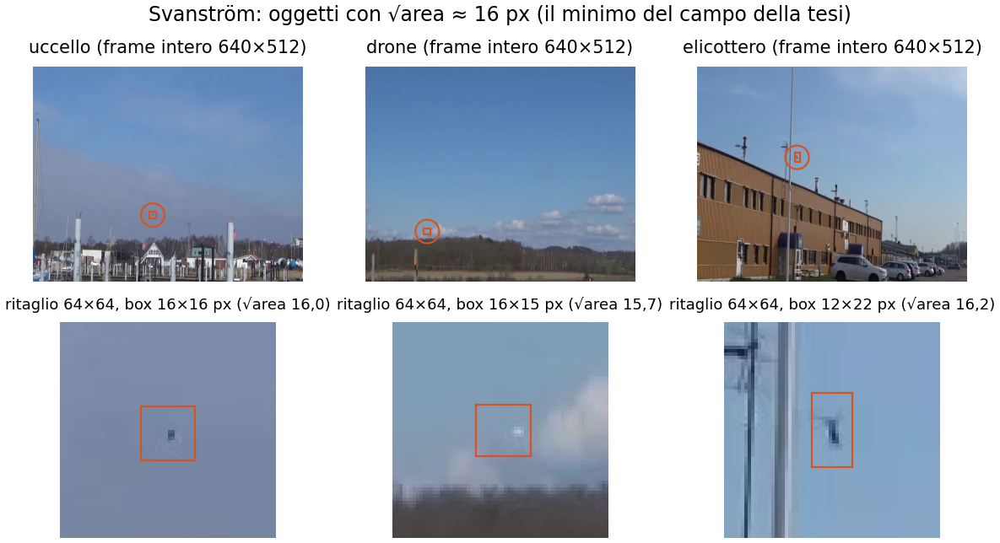

# air-detection

Dataset custom per la tesi sulla detection di oggetti in volo su dispositivi edge (repo dei modelli e delle misure:
`~/Desktop/yoloeval`, piano in `NEW_MASTERPLAN.md`).

**Scenario**: torretta anti-drone a terra, camera rivolta verso il cielo, **a colori** (la scala di grigi non basta).
**Classi**, in quest'ordine: `0 airplane`, `1 bird`, `2 drone`, `3 helicopter`.

## In breve

- **Base: Svanström** (285 video visibili, 640×512, da terra verso il cielo): l'unico dataset trovato con tutte e
  quattro le classi negli stessi video e con la stessa camera.
- **Aggiunte** solo per i buchi della matrice classe × fascia di grandezza, portate a 640×512.
- **Tutte le immagini 640×512**: non ci sono fonti ad alta risoluzione.
- **Box aderenti all'oggetto**: quelli originali di Svanström sono larghi e si correggono (SAM 2 + revisione).
- **Split per video** 70/20/10, val e test senza oggetti sotto i 16 px, bilanciati su classe × fascia.
- **Set di val e test alle risoluzioni di deploy** (480p, 720p, 1080p) costruiti come mosaici.

## Documenti

| file | contenuto |
|---|---|
| [`docs/regole.md`](docs/regole.md) | le regole fisse e cosa deve consegnare questa repo a yoloeval |
| [`docs/procedura.md`](docs/procedura.md) | i 10 passi di costruzione, nell'ordine |
| [`docs/svanstrom.md`](docs/svanstrom.md) | cosa sappiamo di Svanström: formato, label, numeri, box larghi |
| [`docs/ricerca_fonti.md`](docs/ricerca_fonti.md) | la ricerca delle fonti (12–13/10/2026), le fonti di AOD4, le decisioni |
| [`docs/da_decidere.md`](docs/da_decidere.md) | punti aperti, rischi e limiti da dichiarare |

## Strumenti

| file | cosa fa |
|---|---|
| `tools/svanstrom.py` | scarica Svanström, legge le label `.mat`, seleziona i frame con hash semantico, crea il background per inpainting, fa lo split per video e i sottoinsiemi per fascia. Copiato da yoloeval: è il punto di partenza, va adattato alle regole nuove (fasce, 16 px, box corretti) |
| `tools/plots.py`, `tools/thesis.mplstyle` | stile dei grafici del report, uguale a quello della tesi |
| `tools/aod4_fonti.py` | risale alle fonti di AOD4 dai nomi dei file (solo come riferimento: AOD4 non si usa) |

```bash
python tools/svanstrom.py --out data/svanstrom --src data/svanstrom_src
```

Dipendenze: `numpy`, `opencv-python`, `matplotlib` (vedi `requirements.txt`). I dati stanno in `data/`, fuori da git.

## Stato

Repo creata il 13/10/2026. Il dataset si costruisce **quando il piano di yoloeval è finito**. Niente è ancora stato
fatto oltre alla ricerca delle fonti e all'analisi dei box di Svanström.

Esempio dei box originali di Svanström (box di 16 px attorno a oggetti di 4–6 px):

