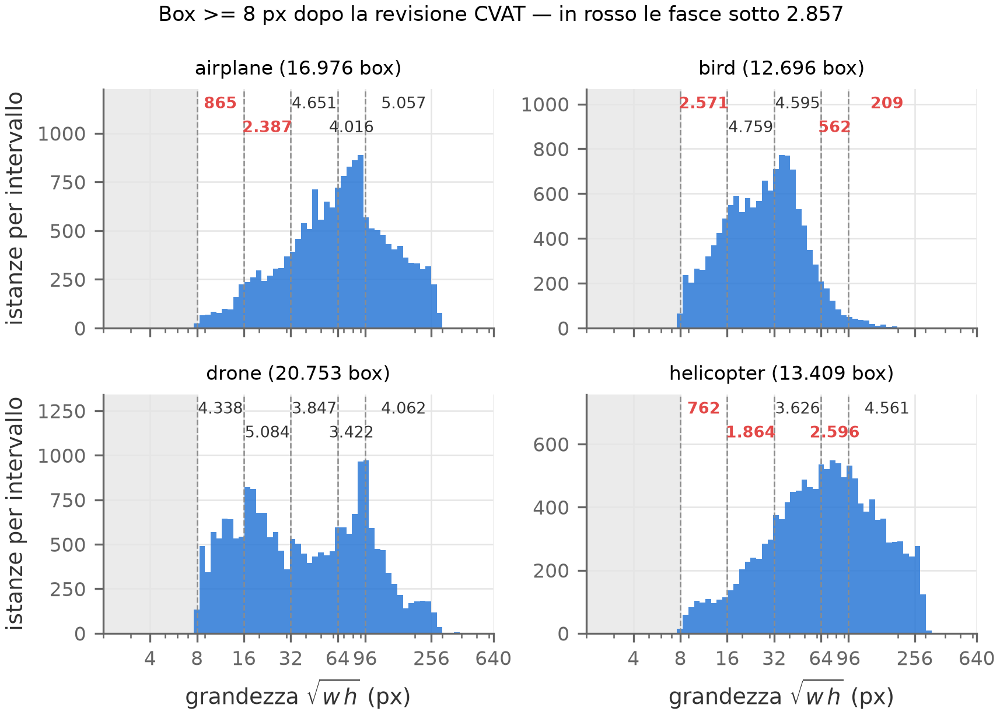
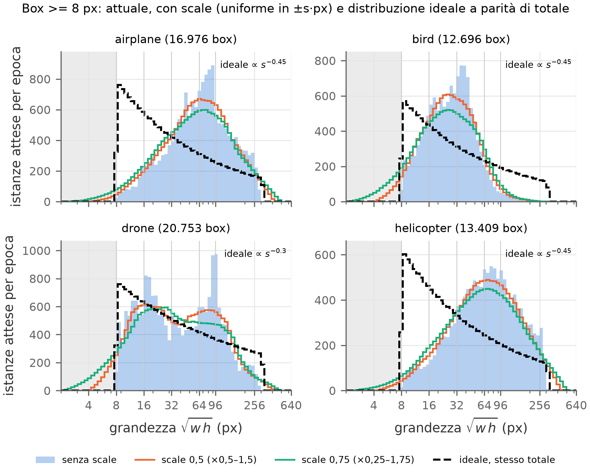

# Distribuzione delle grandezze

Analisi del 22/10/2026 sulle label finali dopo la revisione CVAT, con gli stessi frame di `tools/buchi.py`:
Svanström sui frame tenuti, le aggiunte da `5_box/manuale`. Solo box di almeno 8 px in origine. Grandezza =
√(w·h) in pixel sul frame 640×512. Figure rifatte con `python tools/distribuzioni.py`.

## Distribuzione attuale

| classe | box | 8–16 | 16–32 | 32–64 | 64–96 | > 96 |
|---|---|---|---|---|---|---|
| airplane | 16.976 | **865** | **2.387** | 4.651 | 4.016 | 5.057 |
| bird | 12.696 | **2.571** | 4.759 | 4.595 | **562** | **209** |
| drone | 20.753 | 4.338 | 5.084 | 3.847 | 3.422 | 4.062 |
| helicopter | 13.409 | **762** | **1.864** | 3.626 | **2.596** | 4.561 |

In grassetto le celle sotto il minimo di 2.857 (`regole.md`): 8 buchi su 20.

Aerei ed elicotteri hanno il massimo tra 40 e 200 px e poco sotto i 32. Gli uccelli si fermano quasi tutti
sotto i 64 px. I droni coprono bene tutte le fasce.

## Scale di Ultralytics

Lo `scale` di Ultralytics (`RandomPerspective`) moltiplica il lato di ogni immagine per un fattore uniforme in
[1−s, 1+s]: riduce **e** ingrandisce. Un box di grandezza x diventa quindi uniforme in [x(1−s), x(1+s)].
Le istanze attese in un intervallo [a, b) sono, in modo esatto:

  Σ_box max(0, min(b, x(1+s)) − max(a, x(1−s))) / (2·s·x)

Lo scale non aggiunge istanze: le sposta tra le fasce a ogni epoca. Il conto non include il ritaglio ai bordi
né il filtro `box_candidates` (lato < 2 px, area persa), che tolgono qualcosa in più ai due estremi.

| cella | senza | s = 0,5 | s = 0,75 |
|---|---|---|---|
| aerei 8–16 | 865 | 1.007 | 1.249 |
| aerei 16–32 | 2.387 | 2.611 | 2.899 |
| aerei 64–96 | 4.016 | 3.190 | 2.853 |
| uccelli 8–16 | 2.571 | 2.597 | 2.687 |
| uccelli 64–96 | 562 | 732 | 900 |
| uccelli > 96 | 209 | 259 | 342 |
| elicotteri 8–16 | 762 | 825 | 1.024 |
| elicotteri 16–32 | 1.864 | 2.044 | 2.202 |
| elicotteri 64–96 | 2.596 | 2.345 | 2.144 |
| droni 64–96 | 3.422 | 2.772 | 2.329 |

Con s = 0,75 si chiudono solo gli aerei 16–32, e di poco. In cambio la fascia 64–96, che sta al centro del
picco, si svuota verso i lati: aerei, elicotteri e droni 64–96 scendono sotto il minimo. Aerei ed elicotteri
8–16 e gli uccelli grandi restano lontani. Lo scale allarga la distribuzione, ma non sostituisce la raccolta.
Gli oggetti piccoli ottenuti riducendo un'immagine sono anche più nitidi di quelli ripresi davvero lontani.

## Distribuzione ideale

Ragionamento, senza le regole delle fasce:

1. **Scenario.** La grandezza in pixel va come 1/distanza. Un bersaglio che si avvicina a velocità costante
   resta molto più a lungo piccolo che grande: già con la distanza uniforme la densità va come 1/s², e con
   oggetti sparsi a caso nel cielo è ancora più spostata verso il piccolo. Vederlo presto vuol dire vederlo
   piccolo.
2. **Difficoltà.** Tra 8 e 32 px un oggetto è una macchia di pochi pixel: lì il modello confonde le classi e
   perde gli oggetti. Sopra i 64 px si riconosce facilmente e servono meno esempi, anche se un po' servono.
3. **Ruolo delle classi.** Aerei, elicotteri e uccelli servono soprattutto a non dare falsi allarmi sui droni,
   e la confusione c'è dove tutti sono piccoli. Un aereo da 200 px non si scambia mai per un drone.

Forma scelta: decrescente in modo continuo, densità in scala logaritmica proporzionale a s^−α tra 8 e 320 px.
- **Droni:** α = 0,3, circa −19% per ogni raddoppio di grandezza.
- **Aerei, elicotteri, uccelli:** α = 0,45, circa −27% per raddoppio.

Nella figura la curva ideale ha lo stesso totale della classe: mostra la forma, non quanto manca. Gli α sono
una scelta ragionata, da rivedere. Per gli uccelli grandi, se interessano poco, serve un α più alto.

Rispetto all'ideale:
- **Aerei ed elicotteri** sono rovesciati: troppi tra 40 e 200 px, troppo pochi sotto i 32.
- **Droni:** sono già vicini all'ideale. Mancano un po' gli 8–12 px e quelli sopra i 128; il picco intorno ai
  90 px è di troppo.
- **Uccelli:** troppi tra 20 e 60 px, mancano gli 8–16 e i grandi.

Le fasce di `regole.md` non sono ottave: 64–96 è poco più di mezza ottava e > 96 quasi un'ottava e mezza.
Chiedere lo stesso numero in ogni fascia quindi non è una distribuzione piatta e pesa troppo 64–96.

Per val e test non serve la forma ideale: meglio stratificarli per grandezza, perché la precisione per
grandezza sia affidabile, e riportare i risultati per grandezza invece di una sola mAP. Sotto gli 8 px gli oggetti
in esercizio sono tanti, ma l'annotazione è poco affidabile. Se contano, serve una testa P2 (stride 4) più che
altri dati.
